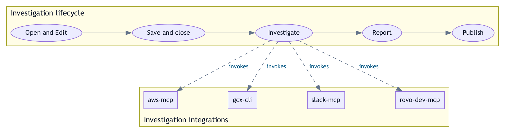

# Investigation Skills

A root cause is rarely visible in one place. The latency spike and the logs are
in Grafana, the throttled resources are in AWS, the deploy that preceded them is
in a pull request, and the first customer symptom is a Slack thread. Reading
each store is easy; relating them is the work — and when that work happens in a
chat session, the conclusion survives and the reasoning behind it does not.

This repository keeps the reasoning. Describe the problem once in a task file;
your coding agent queries the resources in scope, relates their signals on one
timeline, narrows to a cause and a resolution, and writes a report in which
every material claim is pinned to its evidence. Publishing that report turns one
person's investigation into something the rest of the team can build on.

**You talk to the agent; the agent runs the tools.** Anything shown as `text`
below is a request you make to your coding agent while this repository is open —
not a shell command. The agent follows the repository [policy](AGENTS.md) and
the [skills](#skills) it routes to.

<picture>
  <source media="(prefers-color-scheme: dark)" srcset="diagrams/DIAGRAM-investigation-workflow-dark.png">
  
</picture>

**Figure 1 — Lifecycle.** Solid arrows are handoffs; dashed arrows are the
integrations the investigation calls as the task requires, in no fixed order.
([source](diagrams/DIAGRAM-investigation-workflow.dot))

## Why use it

- **One entry point.** `open task` produces a structured draft; saving and
  closing the editor runs it. No per-investigation prompt engineering.
- **Correlation, not just collection.** Metrics, logs, traces, AWS resource
  state, code, tickets, and conversation are aligned on one time window.
- **The systems you already use.** AWS, Grafana, Slack, Bitbucket, GitHub, Jira,
  and Confluence, through read-only skills — only the ones your task names.
- **Access is part of the job.** Each skill owns its sign-in and diagnoses its
  own failures, so an expired session does not stall the investigation.
- **Evidence you can audit.** Reports keep inspected source, observed runtime
  behavior, inference, and proposal apart, and link claims to a pinned evidence
  index.
- **Work that compounds.** A published report is the record a teammate extends,
  instead of a transcript that expires with the session.
- **Authorization stays with you.** A task describes work. It never grants
  permission to commit, update a ticket, deploy, or publish; publishing happens
  only when you ask.

## Requirements

- A coding agent that reads [AGENTS.md](AGENTS.md) or [CLAUDE.md](CLAUDE.md).
- CodeGraph and Python 3.
- Access to the systems your task names. Each integration's tooling and sign-in
  are handled by its own skill when first needed.

The agent installs missing required tools itself — see
[Required Dependencies](AGENTS.md#required-dependencies). The workflow works
best in an IDE with the agent in the integrated terminal: the task draft opens
in an editor tab beside the session, and closing that tab starts execution.

## Quick start

1. **Open a draft.**

   ```text
   open task
   ```

   The agent creates `docs/tasks/TASK.md` from the
   [template](templates/TASK.md) and opens it in your editor. An existing draft
   is preserved, not replaced.

2. **Fill it in.** A task needs four things:

   | Section | What to write |
   | --- | --- |
   | Title | A short name; the task and report files are named from it. |
   | Problem | What is wrong — pasting the alert text or thread is fine. |
   | Acceptance Tests | At least one observable outcome, such as *identify the root cause*. |
   | Resources | At least one real resource: a repository, Slack channel, AWS profile and Region, Grafana context, or alert. Delete the lines that do not apply. |

3. **Save and close the editor tab.** That alone starts the investigation; no
   separate `run` request is needed. Saving without closing does not start it.

4. **Read the report.** The agent writes `docs/reports/REPORT-{slug}.md` and a
   PDF, and renames the task to `docs/tasks/TASK-{slug}.md`.

5. **Publish it** when you want the team to have it — see
   [Publish the report](#publish-the-report).

To revisit an investigation, name its file:

```text
edit task docs/tasks/TASK-example-service-investigation.md
```

To stop before execution, ask for **edit only** (or **initialization only** for
a new draft).

### Reuse resources with profiles

Save the resources you use repeatedly once, then load them into any draft:

```text
add profile prod-us
load profile prod-us into the task
```

The agent stores the values you give it in a local `.env` file that stays out
of Git. Profiles hold identifiers only, never credentials. You can also
compose profiles — for example an environment profile plus an application
profile — into one named profile. Anything you write in the task yourself always
wins over a profile value. Details:
[Profile Manager](skills/profile-manager/SKILL.md).

### Task settings

Optional lines in the task's Resources section adjust how a run behaves:

| Setting | Default | Effect |
| --- | --- | --- |
| `Publish: <page or repository>` | none | Where the report is published; repeat the line for several destinations. Best set once in a profile — see [Publish the report](#publish-the-report). Publishing still needs your request. |
| `Grafana Assistant: disabled` | enabled | Skips Grafana Assistant prompts, which can incur fees beyond ordinary Grafana usage; direct queries still run. |
| `Fan-out: disabled` | enabled | Investigates in one session instead of parallel sub-agents. Can be saved in a profile. |
| `Generate Markdown: disabled` | enabled | Skips the Markdown report artifact; PDF and HTML remain independent. |
| `Generate PDF: disabled` | enabled | Skips the PDF report artifact. |
| `Generate HTML: enabled` | disabled | Generates a portable HTML report and includes it in authorized publication. |
| `HTML theme: light` | system | Selects fixed `light`, fixed `dark`, or `system` appearance for the HTML download canvas and diagrams. |
| `Rhyming endpoints: <JSON>` | none | Past investigations, pages, channels, or repositories to search for similar incidents. |
| `Rhyming historical window days: <n>` | `7` | How far back that search looks. |

Every on/off setting takes `enabled` or `disabled`, in a task or in a profile.
Spelling is forgiving: `fan out: disabled`, `FAN_OUT=DISABLED`, and
`Fan-out: Disabled` all mean the same thing.

If you edit `.env` or a task by hand, or have settings from an earlier version,
the agent will tell you when it finds values in an old or unusual form. To tidy
them up, ask:

```text
lint profiles
lint task docs/tasks/TASK.md
```

It rewrites what has one correct answer and asks you about anything that does
not, such as an illegal value or the same setting given twice with different
values.
Tasks and profiles written with the earlier `Generate PDF: T` or `F` keep
working; they are read as `enabled` and `disabled`.

## What a run looks like

A flapping alert is the ordinary case. Illustrative, not a recorded finding:

**What goes in.** The alert text as the problem. The Slack channel the thread
is in, the Grafana context that holds the alert, the AWS profile and Region the
workload runs in, and the repository that owns the service as resources.
*Identify the root cause*, *propose a resolution*, and *say what remains
unverified* as acceptance tests.

**What comes back.** A report with a timeline that puts the alert transitions,
the metric series, the deploy, and the thread on one clock; the cause the
evidence supports; a diagram of the path involved; a proposed fix; the questions
still open; and the duration and token cost of the run.

**Why it is worth keeping.** A flapping alert is often a symptom — a duplicated
collection path double-counting a series, say — rather than a threshold that
needs widening. Tuning the alert hides it; the report names it, and the next
person who sees the alert flap starts from there.

## How an investigation runs

Whatever the resources in scope, the agent works through the same arc:

1. **Gather.** Queries go to every store the task names, each through its own
   read-only skill, with the account, context, Region, and time window resolved
   first rather than guessed.
2. **Relate.** Signals are aligned on one explicit time window and timezone, so
   an alert transition, a log burst, a deploy, and a customer report become one
   picture. Human reports count as data: a Slack message timestamps the first
   user-visible symptom and says which excursions mattered.
3. **Narrow.** A finding in one store becomes the next query in another, until
   a cause survives the evidence. Source code proves what the code says, not
   what production did.
4. **Write up.** The report separates what the evidence verifies from what it
   only suggests, and records the questions still open.
5. **Publish.** The report becomes a page or repository entry the team can read,
   cite, and extend.

Three behaviors are on by default. Each is owned by a skill, which holds the
full rules:

| Behavior | What happens | Details |
| --- | --- | --- |
| Per-store fan-out | When a task names several stores, repositories, or Slack channels, one read-only sub-agent inspects each in parallel. The main session alone relates, verifies, and reports. | [Skill](skills/per-store-fan-out/SKILL.md) · [diagram](diagrams/DIAGRAM-per-store-fan-out.svg) · [notes](diagrams/DIAGRAM-per-store-fan-out.md) |
| Parallel Grafana queries | Every Grafana query runs twice at once — Grafana Assistant and direct `gcx` — and the results are reconciled. Assistant conclusions are leads until verified. | [Skill](skills/parallel-grafana-investigation/SKILL.md) · [diagram](diagrams/DIAGRAM-parallel-alert-investigation.svg) · [notes](diagrams/DIAGRAM-parallel-alert-investigation.md) |
| Rhyming incident search | When rhyming endpoints are configured, one read-only sub-agent per endpoint looks for similar past incidents. | [Skill](skills/rhyming-incident-search/SKILL.md) · [diagram](diagrams/DIAGRAM-rhyming-incident-search.svg) · [notes](diagrams/DIAGRAM-rhyming-incident-search.md) |

Sub-agents only read: they never mutate, acknowledge, message, or publish. Long
runs pause at a ten-minute soft checkpoint to surface findings and gaps before
continuing.

## What you get

| Path | Purpose |
| --- | --- |
| `docs/tasks/TASK.md` | The draft you edit. |
| `docs/tasks/TASK-{slug}.md` | The finalized task, named from its title. |
| `docs/reports/REPORT-{slug}.md` and `.pdf` | The investigation report. |
| `docs/reports/assets/{slug}/` | Diagrams and other report assets. |
| `logs/` | Investigation logs and supporting evidence. |
| `.env` | Your resource profiles. |

All of it is local and ignored by Git: findings about live systems are never
committed here. The published page or repository, not this checkout, is the shared copy. An
existing draft or a filename collision is left for you to resolve rather than
overwritten.

## Publish the report

A report can be published to one or more destinations, of two kinds:

| Destination | What you get |
| --- | --- |
| A Confluence page | The report as a child page, with its diagrams and evidence, and the original report and task attached as downloads. |
| A GitHub or Bitbucket repository | The report, task, PDF, and assets on a branch, with a pull request for you to review and merge. |

For an HTML-only Confluence report, use `publish it --report <HTML path> --parent <page URL>
HTML only, light mode` (or dark/system mode). Only HTML report downloads are uploaded; the
available parent TASK and cited evidence remain supporting attachments. The HTML download
retains its selected appearance and embedded diagrams. The readable Confluence page follows
the viewer's page theme, with native figure behavior verified separately. See
[HTML-only Confluence publication](skills/publish-it/references/confluence-html-only.md).

### Set the destinations once

Set destinations in the profile you load into your tasks, rather than in every
task. For example, to publish under an "Investigations" launch page in
Confluence:

```text
edit profile: Prod US, add publish: https://<company>.atlassian.net/wiki/spaces/PRD/pages/4547051801/Investigation
```

To publish to a repository as well, add it the same way. A profile holds up to
16 destinations:

```text
edit profile: Prod US, add publish: https://github.com/<org>/investigation-reports
```

From then on, loading the profile into a task fills them in for you:

```text
load profile: Prod US
```

```markdown
- Publish: `https://<company>.atlassian.net/wiki/spaces/PRD/pages/4547051801/Investigation`
- Publish: `https://github.com/<org>/investigation-reports`
```

Give a repository destination the branch and directory to publish into, such
as `https://github.com/<org>/investigation-reports/tree/main/reports`. Without a
directory, the agent uses the location that repository documents for reports,
and asks you if there is none.

### Publish

When the report is ready, ask:

```text
publish it --task docs/tasks/TASK-example.md
```

[Publish It](skills/publish-it/SKILL.md) publishes to every `Publish:` line in
the task and reports a result for each. Destinations are independent: if one
fails, the others still publish.

- **No destination, no guess.** If the task has no `Publish:` line, nothing is
  published. The agent asks you to either supply a destination, which it adds
  to the task's Resources, or add it to your profile and reload the profile so
  the question does not come up again.
- **One-off changes.** Edit the `Publish:` lines in a single task, or name
  destinations in the request with `--parent <Confluence page URL>` or
  `--repo <repository URL>`. Either replaces the profile's list for that
  publication. You can also narrow it: `publish it … to Confluence only`.
- **Repositories are never pushed to directly.** The agent pushes a
  `publish/<slug>` branch and opens a pull request; merging is yours. A public
  repository needs your explicit confirmation first.
- **Publishing does not rerun anything.** It presents the investigation as it
  was recorded. Republish a revised report rather than editing a page or
  branch away from its evidence.

## Skills

| Skill | Responsibility |
| --- | --- |
| [Open/Edit/Close/Execute](skills/open-edit-close-execute/SKILL.md) | Open a task in the editor, wait for it to close, then execute it. |
| [Workflow Artifact Naming](skills/workflow-artifact-naming/SKILL.md) | Name and place tasks, reports, logs, and assets. |
| [Profile Manager](skills/profile-manager/SKILL.md) | Maintain local resource profiles and load them into a task. |
| [Per-Store Fan-Out](skills/per-store-fan-out/SKILL.md) | Inspect multiple stores, repositories, or channels in parallel. |
| [Parallel Grafana Investigation](skills/parallel-grafana-investigation/SKILL.md) | Answer Grafana queries with Assistant and direct `gcx` agents, then reconcile. |
| [Rhyming Incident Search](skills/rhyming-incident-search/SKILL.md) | Find related prior incidents. |
| [Source Investigation](skills/source-investigation/SKILL.md) | Trace a problem to source code, root cause, and a proposed fix. |
| [Report Continuation](skills/report-continuation/SKILL.md) | Keep one canonical report updated and preserve task context for another user or agent to resume. |
| [Report Evidence](skills/report-evidence/SKILL.md) | Evidence index, citations, and stated limitations. |
| [Diagramming Style](skills/diagramming-style/SKILL.md) | Readable diagrams in light and dark themes. |
| [AWS Architecture Diagrams](skills/aws-architecture-diagrams/SKILL.md) | AWS architecture and data-flow diagrams. |
| [Token Usage](skills/token-usage/SKILL.md) | Report duration and token totals. |
| [Publish It](skills/publish-it/SKILL.md) | Publish tasks and reports to Confluence pages and GitHub or Bitbucket repositories. |
| [AWS MCP](skills/aws-mcp/SKILL.md) | AWS sign-in and read-only queries. |
| [Grafana CLI](skills/gcx-cli/SKILL.md) | `gcx` setup, sign-in, and read-only queries. |
| [Slack MCP](skills/slack-mcp/SKILL.md) | Slack access and diagnosis. |
| [Rovo Dev MCP](skills/rovo-dev-mcp/SKILL.md) | Bitbucket, Jira, and Confluence access. |
| [Skill Ownership](skills/skill-ownership/SKILL.md) | Audit this repository against the ownership principle, run its checks, and sync the carried copy. |
| [Release It](skills/release-it/SKILL.md) | Release this repository. |

<picture>
  <source media="(prefers-color-scheme: dark)" srcset="diagrams/DIAGRAM-investigation-skill-routing-dark.png">
  
</picture>

**Figure 2 — Skill routing.** The lifecycle of Figure 1 expanded into the skill
that owns each step. Dashed arrows are invocation; the solid arrow is delivery.
([source](diagrams/DIAGRAM-investigation-skill-routing.dot) ·
[notes](diagrams/DIAGRAM-investigation-workflow.md))

## Skill philosophy

Each capability is treated like a code module — "skill as code". It has exactly
one owner (its skill), a clear interface (the `description` the router matches),
and its own tests (an eval case in `skill_evals/cases/`). The root
[AGENTS.md](AGENTS.md) and [CLAUDE.md](CLAUDE.md) are a router, not a manual:
they say which request goes to which skill and hold only the policy no skill
covers. So when you need the rule for something, follow the skill link above
rather than a summary here.

CI enforces the model. The [Skill Quality Gate](AGENTS.md#skill-quality-gate)
exercises every skill's structure, routing, and behavior, and drift checks fail
when workflow content accretes in the root files or the README and diagrams fall
out of step ([policy/root-contract.json](policy/root-contract.json)). New
workflow content therefore belongs in a skill with an eval case, never in the
routing files.

The principle and its checks come from the upstream
[skill-ownership](https://github.com/orenlion1/skill-ownership) repository.
This repository carries a versioned copy in
[skills/skill-ownership](skills/skill-ownership/SKILL.md) and records the release it
took in [policy/skill-ownership-pin.json](policy/skill-ownership-pin.json); the checks
fail when the two disagree.

## Contributing

Run the checks CI runs, from the repository root:

```sh
bash scripts/check.sh                    # tests and the carried ownership checks
bash scripts/run-skill-quality-gate.sh   # also required after changing a skill or eval case
bash scripts/render-workflow-diagram.sh  # regenerate diagrams after editing a .dot source
bash scripts/check-disclosure.sh         # credential and institutional-data scan before a first upload
```

- [AGENTS.md](AGENTS.md) and [CLAUDE.md](CLAUDE.md) are byte-identical; change
  policy in both.
- Changes land through a protected squash pull request with the required
  `Tests` check.
- [SECURITY.md](SECURITY.md) covers what may be committed and the local
  pre-push hook.
- [VERSION](VERSION) holds the release version. Ask the agent to
  `run release-it`; [VERSIONING.md](VERSIONING.md) holds the contract.

## License

[MIT License](LICENSE). External tools retain their own licenses.
