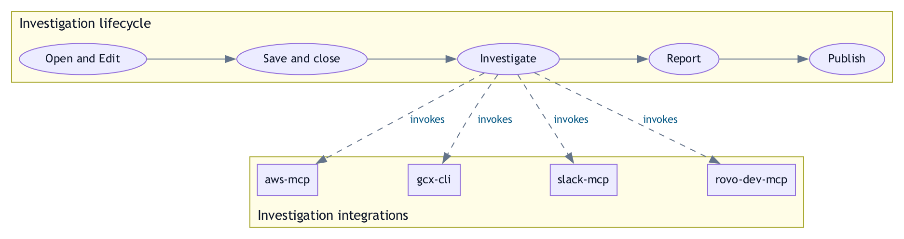
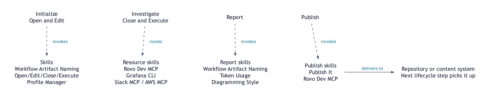

# Investigation Skills

Turn an investigation into a saved task, verified evidence, and matching
Markdown and PDF reports. Your coding agent drives the workflow using the
repository's [policy](AGENTS.md) and [skills](#skills).

## Initialize an investigation

Open this repository in your coding agent and ask:

```text
open task
```

The agent creates a draft from [templates/TASK.md](templates/TASK.md) and opens it
in a waiting editor. Enter a task title, problem, observable acceptance tests,
and the relevant resource identifiers.

## Run Investigation

**Save and close the task editor to start execution automatically.**

Once any supplied checks pass, the agent names the task, runs its saved requirements, and
produces reports. **No separate `run` instruction is needed.**

## Hydrate Investigation

To edit and run an existing task, supply its actual path:

```text
edit task docs/tasks/TASK-example-service-investigation.md
```

These are requests to the agent, not shell commands. For editing without execution,
explicitly request **edit only**; an **initialization-only** request likewise stops
at that boundary. Existing task edits preserve their filenames.

## Workflow

<picture>
  <source media="(prefers-color-scheme: dark)" srcset="diagrams/DIAGRAM-investigation-workflow-dark.png">
  
</picture>

**Figure 1 — Lifecycle and integrations.** Open and edit the task, save and close its
editor to start execution, then investigate and produce verified reports. The
artifacts progress from `TASK.md` to the saved task, findings and evidence, and
Markdown/PDF reports. Supplied
checks must pass and the saved task must be reread before execution. New drafts
receive a title-derived filename; existing tasks keep their identity. Edit-only
and initialization-only requests limit the continuation. Missing information or
unresolved ownership blocks only dependent work. Dashed arrows show Investigate
invoking `aws-mcp`, `gcx-cli`, `slack-mcp`, and `rovo-dev-mcp` as needed for the
task; these integrations have no implied execution order. The Report → Publish
handoff requires separate publication authorization.

[Editable diagram](diagrams/DIAGRAM-investigation-workflow.dot) ·
[Light SVG](diagrams/DIAGRAM-investigation-workflow-light.svg) ·
[Dark SVG](diagrams/DIAGRAM-investigation-workflow-dark.svg)

<picture>
  <source media="(prefers-color-scheme: dark)" srcset="diagrams/DIAGRAM-investigation-skill-routing-dark.png">
  
</picture>

**Figure 2 — Skill routing.** Dashed arrows show which skills an activity invokes.
The task uses only the resource integrations it needs; listing a skill does not
make its Resources field mandatory. Peer placement does not imply execution order
between skills. Both views use this repository's
[task workflow](AGENTS.md#templated-tasks) and
[editor contract](skills/open-edit-close-execute/references/open-edit-close-execute.md).

[Editable routing diagram](diagrams/DIAGRAM-investigation-skill-routing.dot) ·
[Light SVG](diagrams/DIAGRAM-investigation-skill-routing-light.svg) ·
[Dark SVG](diagrams/DIAGRAM-investigation-skill-routing-dark.svg) ·
[Source notes and regeneration](diagrams/DIAGRAM-investigation-workflow.md)

The repository owns the template, draft creation, final naming, execution, and
reporting. The shared Open/Edit/Close/Execute skill owns the waiting-editor barrier
and invokes that continuation. For VS Code the waiting command is
`code --reuse-window --wait "<task-path>"`. Saving alone or a timeout never counts
as editor closure. See the [full editor contract](skills/open-edit-close-execute/references/open-edit-close-execute.md)
for other editors and an explicit saved-and-closed confirmation when closure
cannot be tracked.

Task contents do not grant permission for ticket updates, commits, publication,
deployment, or other actions beyond the user's authorized scope.

For Grafana alert investigations, first propose parallel Grafana Assistant and
`investigate-alert` sub-agents without running investigation commands. Execute the plan
only after explicit authorization, using the same context, alert, time window, and
read-only scope for both agents. See the [alert investigation policy](AGENTS.md#grafana-investigation-entry-point).

## Resources and evidence

The template has fields for a Bitbucket or GitHub repository, Slack channel, AWS profile,
Grafana context, and alert name or UID. Each field is optional; at least one actual
resource is required before execution. Omit or leave blank fields that do not apply.
Use supplied or verified identifiers; placeholders and examples do not count as
selected resources. An alert name or UID is sufficient to identify an alert resource.
Identify the repository's hosting provider from its supplied URL or verified context
before selecting Bitbucket or GitHub tooling; a repository name alone does not select a provider.

Missing optional fields do not block the whole task or trigger unrelated integrations.
Resolve any account, repository, context, Region, object identity, or time window
needed by a specific operation before performing it, and continue independent work.
If no actual resource is available in the task or user context, request at least one.

Before a repository investigation, probe Bitbucket, Jira, and Confluence through
the [Rovo Dev MCP skill](skills/rovo-dev-mcp/SKILL.md). Use separate product grants,
live tool schemas, and a bounded object read per product. A successful probe proves
access to that sampled object; behavioral findings require their own evidence.
These probes do not require an Atlassian resource for a task scoped to other
integrations, and blank optional fields alone do not trigger connectivity checks.

Reports distinguish inspected source, observed runtime behavior, inferences,
unanswered questions, and proposed changes. Material claims link to an evidence
index with revision-pinned source references. Markdown and PDF retain matching
claims, diagrams, captions, limitations, and links. The complete requirements are
in [Report Evidence](AGENTS.md#report-evidence) and
[Report Diagrams](AGENTS.md#report-diagrams).

Use [Token Usage](skills/token-usage/SKILL.md) to generate and validate each report's
token usage report and metadata. That skill owns the collection, accounting, and
presentation requirements for every report format.
Load it before opening a templated task: `open task` and `edit task` (including
case and `.md` aliases and inline edit requirements) use the verified native
task-resolution record to bind accounting to the saved task. No extra `run` request
is needed. Missing or conflicting proof remains an accounting limitation.

To publish saved investigation artifacts to Confluence, use
[Publish It](skills/publish-it/SKILL.md) with a task path, report path, or both:

```text
publish it --task docs/tasks/TASK-example.md --report docs/reports/REPORT-example.md --parent <Confluence parent URL>
```

The skill resolves related artifacts, publishes the report with its diagrams and evidence,
and includes the original report and parent task as supporting downloads. It preserves the
investigation's evidence window and token cutoff. A task-only or report-only request uses
verified companion files when available and reports any missing companion. These are
instructions to the agent; publishing requires a resolved Confluence destination.

## Files and outputs

| Path | Purpose |
| --- | --- |
| [templates/TASK.md](templates/TASK.md) | Reusable task template; copied when starting a new task. |
| `docs/tasks/TASK.md` | Local temporary task draft; ignored by Git. |
| `docs/tasks/TASK-{slug}.md` | Local finalized task, named from its saved title; ignored by Git. |
| `docs/reports/REPORT-{slug}.md` and `.pdf` | Local investigation deliverables; ignored by Git. |
| `docs/reports/assets/{slug}/` | Local supporting report assets. |
| `logs/` | Local investigation logs and supporting evidence; ignored by Git. |
| [diagrams/](diagrams/) | Committed documentation diagrams and editable source. |
| [skills/](skills/) | Self-contained skill packages and their references or helpers. |

[Workflow Artifact Naming](skills/workflow-artifact-naming/SKILL.md) resolves output
paths before writes: explicit destination first, then repository configuration,
then defaults. Existing drafts and destination collisions are preserved for
resolution; they are never silently overwritten or given a numeric suffix.

The default `docs/tasks/`, `docs/reports/*`, `logs/`, and `outputs/` locations are ignored.
The reusable [task template](templates/TASK.md) remains tracked. Custom output
destinations need their own appropriate tracking decision. The former `inputs/`
directory is retired; saved tasks contain their investigation requirements.

## Skills

| Skill | Responsibility |
| --- | --- |
| [Open/Edit/Close/Execute](skills/open-edit-close-execute/SKILL.md) | Wait for editor closure and supplied checks, then continue within scope. |
| [Workflow Artifact Naming](skills/workflow-artifact-naming/SKILL.md) | Resolve artifact identity, format, filename, and destination. |
| [Release It](skills/release-it/SKILL.md) | Prepare and verify protected GitHub releases. |
| [Publish It](skills/publish-it/SKILL.md) | Publish tasks and reports to Confluence with diagrams, evidence and verified downloads. |
| [Token Usage](skills/token-usage/SKILL.md) | Derive scoped report duration and token totals from local conversation records. |
| [Diagramming Style](skills/diagramming-style/SKILL.md) | Create and verify readable diagrams in light and dark themes. |
| [Rovo Dev MCP](skills/rovo-dev-mcp/SKILL.md) | Authenticate and perform scoped Atlassian resource reads. |
| [Grafana CLI](skills/gcx-cli/SKILL.md) | Install gcx and its Claude/Codex skills, refresh before commands, authenticate a selected context, and investigate through scoped queries. |
| [Slack MCP](skills/slack-mcp/SKILL.md) | Establish and verify scoped Slack access. |
| [AWS MCP](skills/aws-mcp/SKILL.md) | Authenticate a selected AWS profile, wait for browser sign-in, and investigate root causes through scoped AWS MCP queries. |
| [AWS architecture diagrams](skills/aws-architecture-diagrams/SKILL.md) | Document AWS architecture with the bundled diagram conventions. |

## Local validation

Use a working CodeGraph installation and Python 3. Service-specific tools and
authentication are described in their skills. Required dependency setup follows
[Required Dependencies](AGENTS.md#required-dependencies).

Run from the repository root:

```sh
codegraph --version
codegraph init
codegraph status
python3 -m compileall -q skills tests
python3 -m unittest discover -s tests -v
python3 -m unittest discover -s skills/diagramming-style/tests -v
git diff --check
```

Use CodeGraph exploration before code searches or source inspection, and
`codegraph sync` after changes. Keep `.codegraph/` local. Keep [AGENTS.md](AGENTS.md)
and [CLAUDE.md](CLAUDE.md) identical when changing repository policy.

To regenerate both workflow views, including adaptive SVGs, fixed light/dark
exports, and overlap checks:

```sh
bash scripts/render-workflow-diagram.sh
```

Inspect the rendered README in both GitHub themes as well as the exported images.
The [Validate workflow](.github/workflows/validate.yml) runs the required `Tests`
check for pull requests and `main`. Authorized changes reach `main` through a
protected squash pull request after the required check succeeds.

With Gitleaks 8.30.1 installed, validate the secret gate locally with
`python3 scripts/test_secret_scan.py` and `bash scripts/scan-secrets.sh .`.
The scanner requires a complete Git checkout, redacts findings, and rejects
repository suppressions and inline allow comments.
It scans commit messages and every reachable tag annotation as well as historical file
patches, including nested annotations whose individual refs have been deleted.

The [Security workflow](.github/workflows/security.yml) runs the real Gitleaks regression
tests and full-history credential scan plus the institutional-data gate on PRs, merge
queues, branch/tag pushes, and manual requests. The policy rejects private artifacts,
institution fingerprints, corporate email addresses, unreviewed hosts, and identifying
account/ticket values without logging matched content. See [SECURITY.md](SECURITY.md) for
coverage, policy review, required GitHub checks, and the local pre-push hook. Run
`bash scripts/check-disclosure.sh` before uploading: CI cannot prevent the initial upload.

## Versioning and releases

[VERSION](VERSION) is the repository release version. Ask your coding agent to
`run release-it` to invoke the local [Release It skill](skills/release-it/SKILL.md).
It prepares a protected pull request, validates the exact merged revision, pushes
an annotated SemVer tag, verifies its GitHub workflow, and publishes curated release notes.
See [VERSIONING.md](VERSIONING.md) for the release contract and required dependencies.

## License

[MIT License](LICENSE). External tools retain their own licenses.
