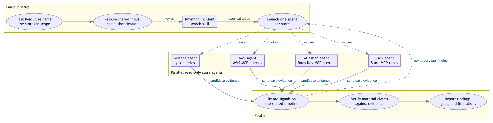
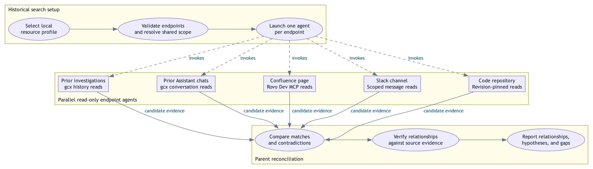
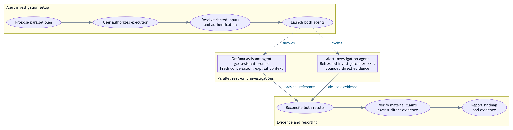

# Investigation Skills

A root cause is rarely visible in one place. The latency spike and the logs
are in Grafana, the resources that were throttled underneath them are in AWS,
the deploy that preceded them is in a pull request, and the first customer
symptom is a Slack thread. Reading each store is easy; relating them is the
work — and when that work happens in a chat session, the conclusion survives
and the reasoning that produced it does not.

This repository keeps it. Describe the problem once in a task file; your coding
agent queries the resources in scope, draws the relationships between their
signals, narrows to a cause and a resolution, and writes the result up as a
report in which every material claim is pinned to the evidence behind it.
Publishing that report is what turns one person's investigation into something
the next lifecycle step — and the rest of the team — can build on.

The workflow is agent-driven. Anything shown as `text` below is something you
say to your coding agent while this repository is open — not a shell command.
The agent follows the repository [policy](AGENTS.md) and the [skills](#skills)
it routes to.

## Why use it

- **One entry point.** `open task` produces a structured draft; saving and
  closing the editor runs it. No per-investigation prompt engineering.
- **Correlation, not just collection.** Metrics, logs, traces, AWS resource
  state, code, tickets, and conversation are pulled onto one time window, so the
  relationships between signals — not just the signals — are what you reason
  about.
- **The systems you already use.** AWS, Grafana, Slack, Bitbucket, Jira, and
  Confluence are reached through scoped read-only skills — only the ones your
  task actually names.
- **Access is part of the job, not a prerequisite.** Each skill owns its own
  sign-in and diagnoses its own failures, so an investigation does not stall on
  an expired session or a profile that was never set up correctly.
- **Evidence you can audit.** Reports keep inspected source, observed runtime
  behavior, inference, and proposal apart, and link material claims to a
  revision-pinned evidence index.
- **Deliverables, not notes.** Markdown and PDF with consistent diagrams,
  captions, stated limitations, and token accounting; optional one-command
  publication to Confluence.
- **Work that compounds.** A published report is the input to the next step of
  the incident lifecycle and the record a teammate extends — instead of a
  transcript that expires with the session, or the same alert investigated twice
  by two people who never saw each other's notes.
- **Authorization stays with you.** A task describes work. It never grants
  permission to commit, update a ticket, deploy, or publish.

## Requirements

A coding agent that reads [AGENTS.md](AGENTS.md) or [CLAUDE.md](CLAUDE.md), a
working CodeGraph installation, and Python 3. Each integration's tooling and
sign-in live in its own skill. A missing required dependency is setup work
rather than a blocker — see
[Required Dependencies](AGENTS.md#required-dependencies).

The workflow works best in an IDE with the coding agent running in terminal
mode in the integrated terminal: the task draft opens in a waiting editor
beside the agent session, and closing that editor is what starts execution.

## Quick start

1. **Open a draft.** Ask the agent:

   ```text
   open task
   ```

   It copies [templates/TASK.md](templates/TASK.md) to a `docs/tasks/TASK.md`
   draft and opens it in a waiting editor. An existing draft is preserved, not
   replaced.

2. **Fill it in.** Give the task a title, the problem, at least one observable
   acceptance test, and at least one real resource — repository, Slack channel,
   AWS profile, Grafana context, or alert. Individual fields are optional;
   placeholders and examples do not count as resources. The template also takes
   a Publish parent page, which records the intended destination with the
   investigation; publication itself stays a separate, authorized step.

   Resources you use repeatedly can be saved once and reused. Ask the agent to
   `add profile example` and then `load profile example into the task`, and
   [Profile Manager](skills/profile-manager/SKILL.md) fills the Resources
   section from a local `.env` store that stays out of Git.

3. **Save and close the editor.** That alone starts execution. Once any
   supplied checks pass, the agent names the task from its title, runs its
   saved requirements, and produces the reports. **No separate `run`
   instruction is needed.**

To revisit an existing investigation, supply its actual path:

```text
edit task docs/tasks/TASK-example-service-investigation.md
```

Existing tasks keep their filenames. To stop before execution, ask for **edit
only**; for a new draft, **initialization only** stops at the same boundary.

## Fan out the queries. Fold in the analysis.

*How an investigation runs.*

Once the task is running, the agent works through the same arc whatever the
resources in scope are:

1. **Gather.** The saved task names what is in scope, and the queries fan out
   across every store in it, each through its own scoped read-only skill, with
   the account, context, Region, object identity, and time window resolved
   before the call rather than guessed. The fan-out is not a single pass: it
   repeats every iteration, as the analysis needs it.
2. **Relate.** The relationships between signals are drawn across the data
   stores that hold them — an alert transition, a log burst, a throttled
   dependency, a deploy, and the customer report that followed are connected
   into one picture instead of read in four tools. Aligning on an explicit time
   window and timezone is how those connections are made. Human reports carry
   data points the telemetry does not: a Slack message that customers started
   seeing checkout timeouts around 09:40 timestamps the first user-visible
   symptom, scopes which customers and features were affected, and tells the
   agent which metric excursions in the window mattered and which were noise.
3. **Narrow.** Candidate causes are tested against that evidence rather than
   asserted: a finding in one store becomes the next query in another, until a
   cause survives the evidence. Code, a schema, or a class name proves what the
   source says, not what production did; the paths and consumers that matter
   are traced before a behavioral conclusion is drawn.
4. **Write up.** The report captures the findings, the reasoning that connects
   them, diagrams of the flows and dependencies involved, and the resolution or
   proposed change — separating what the evidence verifies from what it only
   suggests, and recording the questions still open and what would answer them.
5. **Publish.** The report becomes a page the team can read, cite, and extend.

Step 5 is where the value is captured. Because the evidence index is pinned to
the exact revision, observation window, and objects that produced it, a later
reader can tell what was verified, what has changed since, and what was never
tested. That makes the report a working input rather than a summary: the
postmortem starts from a confirmed timeline, the corrective-action ticket names
a specific defect, the next investigation begins from what has already been
ruled out, and a teammate reads the page instead of reconstructing the
reasoning.

<picture>
  <source media="(prefers-color-scheme: dark)" srcset="diagrams/DIAGRAM-investigation-workflow-dark.png">
  
</picture>

**Figure 1 — Lifecycle and integrations.** The same arc as a flow. Solid arrows
are activity handoffs; dashed arrows are the integrations Investigate calls as
the task requires, in no fixed order. The artifacts progress from `TASK.md` to
the saved task, findings and evidence, and the reports. Publish uses the parent
page configured in the task.

[Editable diagram](diagrams/DIAGRAM-investigation-workflow.dot) ·
[Light SVG](diagrams/DIAGRAM-investigation-workflow-light.svg) ·
[Dark SVG](diagrams/DIAGRAM-investigation-workflow-dark.svg)

<picture>
  <source media="(prefers-color-scheme: dark)" srcset="diagrams/DIAGRAM-investigation-skill-routing-dark.png">
  
</picture>

**Figure 2 — Skill routing.** The same lifecycle expanded into the skill that
owns each step, with each activity labelled by the editor mode it runs in, so
both views share one vocabulary. Investigate routes through the orchestration
skills — Per-Store Fan-Out for multi-store tasks, Parallel Alert Investigation
for Grafana alerts — which invoke the resource skills; a single-store task
without an alert invokes its resource skill directly. Dashed arrows mean
invocation or routing; the solid arrow is delivery — Publish hands the artifact
to a repository or content system, where the next lifecycle step picks it up.
Peer placement implies no ordering, and listing a skill does not make its
resource field mandatory.

[Editable routing diagram](diagrams/DIAGRAM-investigation-skill-routing.dot) ·
[Light SVG](diagrams/DIAGRAM-investigation-skill-routing-light.svg) ·
[Dark SVG](diagrams/DIAGRAM-investigation-skill-routing-dark.svg) ·
[Source notes and regeneration](diagrams/DIAGRAM-investigation-workflow.md)

The repository owns the template, draft creation, final naming, execution, and
reporting. The [Open/Edit/Close/Execute](skills/open-edit-close-execute/SKILL.md)
skill owns the waiting-editor barrier that triggers them: saving alone, or a
timeout, never counts as closure. In VS Code the waiting command is
`code --reuse-window --wait "<task-path>"`; the
[editor contract](skills/open-edit-close-execute/references/open-edit-close-execute.md)
covers other editors and how closure is confirmed when it cannot be tracked.

### Per-store fan-out

When a task's Resources name more than one data store, the gather step fans
out by default: one read-only sub-agent per named store, launched in parallel
with the same resolved identity, environment, time window, timezone, and
questions. You can disable it — by asking, or with `Fan-out: disabled` in the
task's Resources — and the agent investigates inline instead. The default and
its disable switch live in
[Per-Store Investigation Fan-Out](AGENTS.md#per-store-investigation-fan-out);
the [Per-Store Fan-Out skill](skills/per-store-fan-out/SKILL.md) owns the
mechanics — store resolution, brief templates, launch and degradation, and the
auditable fan-out manifest each run records.

<picture>
  <source media="(prefers-color-scheme: dark)" srcset="diagrams/DIAGRAM-per-store-fan-out-dark.png">
  
</picture>

**Figure 3 — Per-store fan-out.** The parent invokes rhyming incident search once when
profile endpoints are configured, then gathers and relates evidence through store delegation.
All store agents launch before any result is awaited; each returns
candidate evidence, limitations, and follow-up questions for other stores.
Solid arrows are handoffs; dashed arrows are invocation, including the loop in
which a finding in one store becomes the next query in another, continued
through that store's existing agent. The orchestrating session alone relates,
verifies, and reports — sub-agent output is leads, not verified findings, and
sub-agents never mutate, acknowledge, message, or publish. The figure
illustrates the documented workflow, not an executed investigation.

[Editable fan-out diagram](diagrams/DIAGRAM-per-store-fan-out.dot) ·
[Light SVG](diagrams/DIAGRAM-per-store-fan-out-light.svg) ·
[Dark SVG](diagrams/DIAGRAM-per-store-fan-out-dark.svg) ·
[Source notes and regeneration](diagrams/DIAGRAM-per-store-fan-out.md)

### Rhyming incident search

[Rhyming Incident Search](skills/rhyming-incident-search/SKILL.md) looks for relevant prior
incidents and investigations using the selected local profile's optional `RHYMING_ENDPOINTS`
JSON array. [Profile Manager](skills/profile-manager/SKILL.md) validates that field against
the task template. Existing profiles remain valid without it; `.env` stays local and untracked.

Profiles also support `RHYMING_HISTORICAL_WINDOW_DAYS` (positive integer days). New profiles
persist `7` in their local `.env` block when omitted. Profile Manager renders the lookback
into task Resources only when valid rhyming endpoints are configured. Explicit caller search
windows take precedence; otherwise searches look back from the current incident's start.
Legacy endpoint profiles resolve seven days without rewriting the store; their next profile
update persists a missing default.

For a new ignored profile store, run `ignore` and `init` first. These commands illustrate
creating a 30-day profile and updating it to 14 days; replace the example endpoint with your
actual repository. Omitting the window flag on creation saves the seven-day default.

```sh
python3 -B skills/profile-manager/scripts/profile_env.py --repository-root . ignore
python3 -B skills/profile-manager/scripts/profile_env.py --repository-root . init
python3 -B skills/profile-manager/scripts/profile_env.py --repository-root . \
  set --profile history \
  --field 'RHYMING_ENDPOINTS=[{"id":"code","kind":"repository","target":"https://github.com/example/service-a","provider":"github"}]' \
  --field RHYMING_HISTORICAL_WINDOW_DAYS=30
python3 -B skills/profile-manager/scripts/profile_env.py --repository-root . \
  set --profile history --field RHYMING_HISTORICAL_WINDOW_DAYS=14
python3 -B skills/profile-manager/scripts/profile_env.py --repository-root . \
  load --profile history --task docs/tasks/TASK.md --dry-run
```

Each configured endpoint gets its own read-only sub-agent. Independent queries use parallel
capacity waves across prior gcx investigations, prior Grafana Assistant conversations,
configured Confluence pages, Slack channels, and code repositories. The per-store parent
invokes this skill once before its store batch. Reports separate verified relationships,
hypotheses, no matches in the searched scope, and unavailable endpoints. Existing conversation
reads do not send new Assistant prompts; disabled parent fan-out disables nested endpoint agents.
The explicit `grafana-assistant-search` kind sends the complete incident-matching brief through
`gcx assistant prompt` in its configured context. Compatible work shares a combined initial
prompt with one execution owner while every endpoint retains its own child and manifest row.
`Grafana Assistant: disabled` suppresses all prompts while permitted historical reads continue.
A request arriving after the initial prompt is recorded unavailable for reuse; it does not
automatically start another billable prompt. See the
[Assistant matching contract](skills/rhyming-incident-search/references/assistant-search.md) for
preparation, receipts, budgets and evidence verification.

<picture>
  <source media="(prefers-color-scheme: dark)" srcset="diagrams/DIAGRAM-rhyming-incident-search-dark.png">
  
</picture>

**Rhyming incident search.** The boxes illustrate supported endpoint kinds; only configured
endpoints are probed, with one agent per endpoint even when kinds repeat. Solid arrows show
handoffs and dashed arrows show invocation. This depicts the skill contract, not a live run.

[Editable source](diagrams/DIAGRAM-rhyming-incident-search.dot) ·
[Light SVG](diagrams/DIAGRAM-rhyming-incident-search-light.svg) ·
[Dark SVG](diagrams/DIAGRAM-rhyming-incident-search-dark.svg) ·
[Source notes and regeneration](diagrams/DIAGRAM-rhyming-incident-search.md)

### Alert investigations

Grafana alert investigations **inherit their authorization from the request
itself**: asking to investigate the alert is what authorizes the parallel
read-only plan, so the agent resolves the shared inputs and launches both
agents without pausing for separate approval. Missing context — alert
identity, environment, time window, timezone, scope — is asked for, never
guessed through live discovery. The policy's
[entry point](AGENTS.md#grafana-investigation-entry-point) owns the route and
the inherited authorization; the
[Parallel Alert Investigation skill](skills/parallel-alert-investigation/SKILL.md)
owns the two-agent workflow.

Grafana Assistant prompts are enabled by default and may incur additional
fees. Disable them — by asking, or with `Grafana Assistant: disabled` in the
task's Resources — and the investigation continues on direct evidence alone,
recording the disabled branch as a configured limitation.

<picture>
  <source media="(prefers-color-scheme: dark)" srcset="diagrams/DIAGRAM-parallel-alert-investigation-dark.png">
  
</picture>

**Figure 4 — Parallel alert investigation.** Both agents launch — before
either result is awaited — with the same resolved Grafana context, alert
identity, environment, exact time window and timezone, and read-only scope. Solid arrows are handoffs; dashed arrows are invocation;
ovals are activities and boxes are the two agent calls. Assistant conclusions
are investigation leads: material claims are verified against bounded direct
evidence, and disagreements, gaps, and limitations go into the report. The
figure illustrates the documented workflow, not an executed investigation.

[Editable alert diagram](diagrams/DIAGRAM-parallel-alert-investigation.dot) ·
[Light SVG](diagrams/DIAGRAM-parallel-alert-investigation-light.svg) ·
[Dark SVG](diagrams/DIAGRAM-parallel-alert-investigation-dark.svg) ·
[Source notes and regeneration](diagrams/DIAGRAM-parallel-alert-investigation.md)

Investigations use a [ten-minute soft checkpoint](skills/open-edit-close-execute/references/investigation-delivery.md), including setup, reporting and required QA, with observed waits reported separately. It surfaces findings/gaps and explains necessary continuation. Profiles support exact `GENERATE_PDF=T/F`: absent defaults T; explicit task values override profiles. F keeps verified Markdown/evidence/required graphs and skips PDF-only work. Historical PDFs remain preserved and excluded from new companions.

## What a run looks like

A flapping alert is the ordinary case. Illustrative, with placeholder
identifiers — not a recorded finding:

**What goes into the task.** Paste the alert text straight out of the on-call
thread as the problem. Name the resources it touches: the Slack channel the
thread is in, the Grafana context that holds the alert, the AWS profile and
Region the workload runs in, the repository that owns the service. Then state
what a good answer looks like, as acceptance tests — *identify the root cause*,
*propose a resolution*, *say what remains unverified*.

**What comes back.** A task named from its own title, so the investigation is
addressable, and a report containing a timeline that puts the alert transitions,
the metric series, the deploy, and the thread on one clock; the cause the
evidence supports; a diagram of the path involved; a proposed fix; the questions
still open; and the duration and token cost of the run.

**Why it is worth writing down.** A flapping alert is often not a threshold that
needs widening — it is a symptom with a cause underneath, such as a duplicated
collection path double-counting a series so a threshold is crossed and cleared
repeatedly. Tuning the alert hides it; the report names it, and the next person
who sees the alert flap starts from that instead of from scratch.

## What you get

| Path | Purpose |
| --- | --- |
| [templates/TASK.md](templates/TASK.md) | Reusable task template; copied when starting a new task. |
| `docs/tasks/TASK.md` | Local temporary task draft; ignored by Git. |
| `docs/tasks/TASK-{slug}.md` | Local finalized task, named from its saved title; ignored by Git. |
| `docs/reports/REPORT-{slug}.md` and `.pdf` | Local investigation deliverables; ignored by Git. |
| `docs/reports/assets/{slug}/` | Local supporting report assets. |
| `logs/` | Local investigation logs and supporting evidence; ignored by Git. |
| `.env` | Local resource-profile store for task Resources; ignored by Git. |
| [diagrams/](diagrams/) | Committed documentation diagrams and editable source. |
| [skills/](skills/) | Self-contained skill packages and their references or helpers. |

Investigation output stays local: `docs/tasks/`, `docs/reports/*`, `logs/`, and
`outputs/` are ignored, while the task template stays tracked. That split is
deliberate. Source control is for code and reviewed policy; a report is durable
prose that wants versioned pages, comments, and search, so it belongs in a
content system instead. Findings about live systems are therefore never
committed here — the published page, not this checkout, is the shared copy.
Custom destinations need their own tracking decision. Paths are resolved before
any write, and an existing draft or a destination collision is preserved for you
to resolve rather than overwritten or suffixed.

## Publish to Confluence

Configure the publication destination in the task's Resources section:

```text
Publish: <Parent page>
```

For example, `Publish: Confluence page "Investigations"`. Use the parent page's URL
or ID when its title is ambiguous. The saved task supplies this destination to
[Publish It](skills/publish-it/SKILL.md); an explicit `--parent` can also name it:

```text
publish it --task docs/tasks/TASK-example.md --report docs/reports/REPORT-example.md --parent <Confluence parent URL>
```

It resolves related artifacts, publishes the report with its diagrams and
evidence, and attaches the original report and parent task as downloads — so a
reader gets the narrative on the page and the inputs underneath it, and can
reopen the task the findings came from. A task-only or report-only request uses
verified companion files when they exist and reports any that are missing.

Publishing presents the investigation as it was recorded: it does not rerun it
or refresh its evidence window, which is what makes the page citable later.
Republish a revised report rather than editing the page away from its evidence.

## Skills

| Skill | Responsibility |
| --- | --- |
| [Open/Edit/Close/Execute](skills/open-edit-close-execute/SKILL.md) | Wait for editor closure and supplied checks, then continue within scope. |
| [Workflow Artifact Naming](skills/workflow-artifact-naming/SKILL.md) | Resolve artifact identity, format, filename, and destination. |
| [Profile Manager](skills/profile-manager/SKILL.md) | Maintain local `.env` resource profiles and load one into a task's Resources. |
| [Rhyming Incident Search](skills/rhyming-incident-search/SKILL.md) | Find related prior incidents through one read-only agent per configured historical endpoint. |
| [Per-Store Fan-Out](skills/per-store-fan-out/SKILL.md) | Fan a multi-store investigation out into per-store read-only sub-agents and fold their evidence in. |
| [Parallel Alert Investigation](skills/parallel-alert-investigation/SKILL.md) | Investigate a Grafana alert with parallel Assistant and `investigate-alert` sub-agents, then reconcile and verify. |
| [Release It](skills/release-it/SKILL.md) | Prepare and verify protected GitHub releases. |
| [Publish It](skills/publish-it/SKILL.md) | Publish tasks and reports to Confluence with diagrams, evidence and verified downloads. |
| [Token Usage](skills/token-usage/SKILL.md) | Derive scoped report duration and token totals from local conversation records. |
| [Diagramming Style](skills/diagramming-style/SKILL.md) | Create and verify readable diagrams in light and dark themes. |
| [Rovo Dev MCP](skills/rovo-dev-mcp/SKILL.md) | Authenticate and perform scoped Atlassian resource reads. |
| [Grafana CLI](skills/gcx-cli/SKILL.md) | Install gcx and its Claude/Codex skills, refresh before commands, authenticate a selected context, and investigate through scoped queries. |
| [Slack MCP](skills/slack-mcp/SKILL.md) | Establish and verify scoped Slack access. |
| [AWS MCP](skills/aws-mcp/SKILL.md) | Authenticate a selected AWS profile, wait for browser sign-in, and investigate root causes through scoped AWS MCP queries. |
| [AWS architecture diagrams](skills/aws-architecture-diagrams/SKILL.md) | Document AWS architecture with the bundled diagram conventions. |

Each skill does one thing, and the repository [policy](AGENTS.md) is a router
rather than a manual: it says which request goes to which skill and holds only
what no skill owns. That shape is load-bearing. Policy that absorbs every rule
becomes a single file nobody can refine safely, while a skill with one
responsibility can be read, tested, and reused on its own — authenticating a
Grafana context is useful well beyond an investigation. It also has a cost worth
respecting: every skill is something the agent must consider before choosing
one, so the answer to a new requirement is usually a narrower skill or a bundled
reference, not a broader one. Depth lives in each skill's `references/`, where
it loads only when that skill is selected.

## Skill philosophy

This catalog treats each capability like a code module — "skill as code". The root
[AGENTS.md](AGENTS.md)/[CLAUDE.md](CLAUDE.md) files only route requests to their owning
skills: each skill owns its workflow, guidance, and verification, and the root files never
restate or override it. That gives every capability exactly one owner, a clear interface
(its routing trigger — the `description` the router matches), and its own tests (the eval
case in `skill_evals/cases/<name>.json`), so a developer can see and refine capabilities the
way they would modules.

Repository-owned policy is limited to what no skill covers: required dependencies,
CodeGraph, the routing table and its trimmed notes, the source-investigation authorization
grant, Grafana billing/disable facts, the fan-out scope/authority rule, the shared
delegation contract, the quality gate, and the sync rule — exactly the section allowlist
that [policy/root-contract.json](policy/root-contract.json) declares.

Two gates enforce the model in the required CI jobs: the
[Skill Quality Gate](AGENTS.md#skill-quality-gate) exercises every skill's structure,
routing (80% rank-one threshold), and behavioral evals, and the drift checks
(`scripts/check-root-drift.py`, `scripts/check-docs-drift.py`) fail closed when workflow
content accretes in the root files, a skill loses its routing row, the root files diverge
or outgrow their budget, or README/diagram assets drift. New workflow content therefore
belongs in a skill (with an eval case), never in the routing files.

## Where the rules live

This README is the entry point. Each rule has exactly one owner, so follow the
link rather than a summary:

| Topic | Owner |
| --- | --- |
| Task lifecycle, resources, continuation, execution and reports | [Open/Edit/Close/Execute](skills/open-edit-close-execute/SKILL.md) |
| Resource profiles, the local `.env` store, its schema and ignore rules | [Profile Manager](skills/profile-manager/SKILL.md) |
| Evidence index, citations, data pattern graphs, and stated limitations | [Report Evidence](skills/report-evidence/SKILL.md) |
| Source tracing, root cause, and deployed-revision verification | [Source Investigation](skills/source-investigation/SKILL.md) |
| Artifact paths and destinations | [Workflow Artifact Naming](skills/workflow-artifact-naming/SKILL.md) |
| Report duration and token accounting | [Token Usage](skills/token-usage/SKILL.md) |
| Diagram style, theming, flapping-alert graph pair, and consistency | [Diagramming Style](skills/diagramming-style/SKILL.md) |
| Atlassian connectivity probes | [Rovo Dev MCP](skills/rovo-dev-mcp/SKILL.md) |
| Per-store investigation fan-out | [Per-Store Fan-Out](skills/per-store-fan-out/SKILL.md) |
| Shared sub-agent delegation machinery | [Shared Delegation Contract](skills/per-store-fan-out/references/delegation-contract.md) |
| Grafana investigations and authentication | [Grafana CLI](skills/gcx-cli/SKILL.md) |
| Parallel alert sub-agent workflow | [Parallel Alert Investigation](skills/parallel-alert-investigation/SKILL.md) |
| Skill and eval quality gate | [Skill Quality Gate](AGENTS.md#skill-quality-gate) |
| Root and docs drift contract | [policy/root-contract.json](policy/root-contract.json) |
| Publication security and disclosure | [SECURITY.md](SECURITY.md) |
| Release contract | [VERSIONING.md](VERSIONING.md) |

[AGENTS.md](AGENTS.md) and [CLAUDE.md](CLAUDE.md) are byte-identical; change
repository policy in both.

## Local validation

Run the same checks CI runs, from the repository root:

```sh
bash scripts/check.sh
```

That validates release metadata, compiles the scripts, skills, and tests, runs
the repository and diagramming test suites, confirms the two policy files match,
and rejects whitespace errors. It also runs the delegation-contract check, which fails when a
delegating skill restates a rule the
[Shared Delegation Contract](skills/per-store-fan-out/references/delegation-contract.md) owns or
when a skill that delegates is missing from
[policy/delegation-contract.json](policy/delegation-contract.json). The repository suite includes an end-to-end pass
over the [Profile Manager](skills/profile-manager/SKILL.md) chain — ignore
coverage, store creation, adding a profile, loading it into a task, and removal
— which CI also runs as its own named step. Changes to any skill or eval case additionally
need `bash scripts/run-skill-quality-gate.sh`.

Keep the CodeGraph index current and local:

```sh
codegraph status
codegraph sync
```

To regenerate both workflow views — adaptive SVGs, fixed light and dark
exports, and overlap checks:

```sh
bash scripts/render-workflow-diagram.sh
```

Then inspect the rendered README in both GitHub themes alongside the exported
images. The [Validate workflow](.github/workflows/validate.yml) runs the
required `Tests` check on pull requests, merge queues, and `main`; authorized
changes land through a protected squash pull request.

## Security

Investigation output is deliberately untracked, and the repository gates what
can be committed: a full-history credential scan plus an institutional-data
policy that rejects private artifacts, institution fingerprints, corporate email
addresses, unreviewed hosts, and identifying account or ticket values — without
logging matched content. Before any first upload, when CI cannot help yet:

```sh
bash scripts/check-disclosure.sh
```

[SECURITY.md](SECURITY.md) has the coverage, policy review, required checks, and
the local pre-push hook.

## Versioning and releases

[VERSION](VERSION) is the repository release version. Ask your agent to
`run release-it` to invoke the [Release It skill](skills/release-it/SKILL.md),
which prepares a protected pull request, validates the exact merged revision,
pushes an annotated SemVer tag, verifies its workflow, and publishes curated
release notes. [VERSIONING.md](VERSIONING.md) holds the contract.

## License

[MIT License](LICENSE). External tools retain their own licenses.
