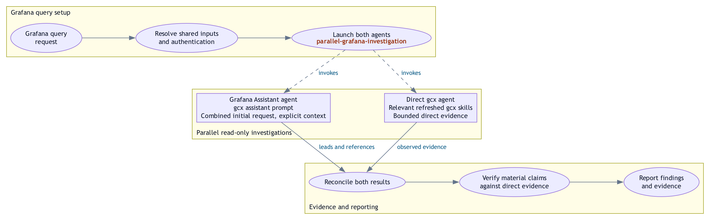

# Parallel Grafana investigation

<picture>
  <source media="(prefers-color-scheme: dark)" srcset="DIAGRAM-parallel-alert-investigation-dark.png">
  
</picture>

The two agents receive the same resolved Grafana context, request, resources, filters, limits, applicable
environment/window/timezone and read-only scope. Both launch
before either result is awaited; the direct investigation proceeds independently
of the Assistant response. Solid arrows show handoffs; dashed arrows show
invocation. Ovals identify activities and boxes identify the two agent calls.
The three shaded rows match the supplied visual reference; the launch activity highlights
`parallel-grafana-investigation` in orange. The main path remains request → resolve inputs
and authentication → launch, with no separate plan-approval step. Prompt ownership is
resolved with the shared inputs before launch.

Assistant conclusions are investigation leads. Retain its prompt, response and
conversation identifiers, references, and limitations. The other agent invokes
the relevant refreshed gcx agent skills (`investigate-alert` for alerts) through the active agent harness;
`gcx agent skills get investigate-alert` only displays instructions. Reconcile
disagreements, verify material claims against bounded direct evidence, and
include gaps and limitations in the report.

This illustrates the documented workflow, not an executed investigation.
The Grafana query request carries the authorization for this
parallel read-only plan; no separate approval step precedes launch. If
parallel delegation is unavailable, report that limitation. Resource changes,
acknowledgments, messages, and publication require separate authorization.

Source: [Parallel Grafana Investigation](../skills/parallel-grafana-investigation/SKILL.md),
routed by the [routing table](../AGENTS.md#routing) under the [Grafana Policy](../AGENTS.md#grafana-policy).
Visual reference: [Investigation workflow](DIAGRAM-investigation-workflow.dot).

Editable [Graphviz source](DIAGRAM-parallel-alert-investigation.dot),
[adaptive SVG](DIAGRAM-parallel-alert-investigation.svg), and explicit
[light](DIAGRAM-parallel-alert-investigation-light.png) /
[dark](DIAGRAM-parallel-alert-investigation-dark.png) images are included.
Regenerate with `bash scripts/render-workflow-diagram.sh` from the repository root.
The renderer derives both palettes from the canonical source and checks SVG overlaps.

## Assistant matching integration

The explicit `grafana-assistant-search` endpoint prepares the matching request before an
Assistant initial prompt. Compatible context/scope/windows share one execution owner and receipt;
every configured endpoint retains its own child and manifest row. Disabled Assistant submits no
prompt while history-only reads and the direct investigation continue. An already-sent prompt
cannot retroactively include matching; no automatic duplicate is submitted. Assistant output is
leads until the parent verifies material source evidence. See
[Assistant matching](../skills/rhyming-incident-search/references/assistant-search.md).

Assistant incurs additional cost and can be disabled with `Grafana Assistant: disabled`.
When disabled, only the direct agent invokes gcx and relevant gcx agent skills; no
Assistant prompt is sent. Internal commands never recursively launch new pairs.
The established diagram asset filenames retain their original alert name for link stability.
