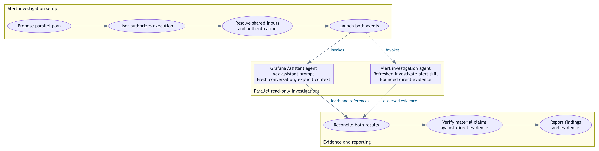

# Parallel alert investigation

<picture>
  <source media="(prefers-color-scheme: dark)" srcset="DIAGRAM-parallel-alert-investigation-dark.png">
  
</picture>

The two agents receive the same resolved Grafana context, alert identity,
environment, exact time window and timezone, and read-only scope. Both launch
before either result is awaited; the direct investigation proceeds independently
of the Assistant response. Solid arrows show handoffs; dashed arrows show
invocation. Ovals identify activities and boxes identify the two agent calls.

Assistant conclusions are investigation leads. Retain its prompt, response and
conversation identifiers, references, and limitations. The other agent invokes
the refreshed `investigate-alert` skill through the active agent harness;
`gcx agent skills get investigate-alert` only displays instructions. Reconcile
disagreements, verify material claims against bounded direct evidence, and
include gaps and limitations in the report.

This illustrates the documented workflow, not an executed investigation.
The request to investigate the alert carries the authorization for this
parallel read-only plan; no separate approval step precedes launch. If
parallel delegation is unavailable, report that limitation. Resource changes,
acknowledgments, messages, and publication require separate authorization.

Source: [Parallel Alert Investigation](../skills/parallel-alert-investigation/SKILL.md),
routed from the [Grafana Investigation Entry Point](../AGENTS.md#grafana-investigation-entry-point).
Visual reference: [Investigation workflow](DIAGRAM-investigation-workflow.dot).

Editable [Graphviz source](DIAGRAM-parallel-alert-investigation.dot),
[adaptive SVG](DIAGRAM-parallel-alert-investigation.svg), and explicit
[light](DIAGRAM-parallel-alert-investigation-light.png) /
[dark](DIAGRAM-parallel-alert-investigation-dark.png) images are included.
Regenerate with `bash scripts/render-workflow-diagram.sh` from the repository root.
The renderer derives both palettes from the canonical source and checks SVG overlaps.
