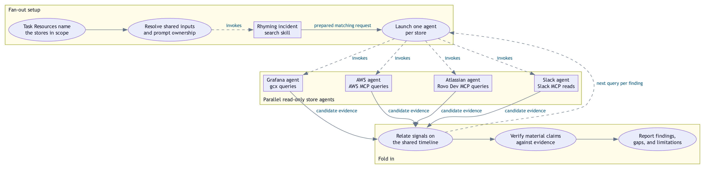

# Per-store fan-out

<picture>
  <source media="(prefers-color-scheme: dark)" srcset="DIAGRAM-per-store-fan-out-dark.png">
  
</picture>

After resolving shared inputs, the parent invokes
[Rhyming Incident Search](../skills/rhyming-incident-search/SKILL.md) once when the selected
profile supplies validated historical endpoints. That skill runs one read-only agent per
endpoint, even when several endpoints use the same store, and returns historical leads before
the ordinary store batch. Its separate manifest records capacity waves and failures. Unset
configuration skips historical search; disabled parent fan-out disables nested endpoint agents.

Each store agent receives the same resolved block — identity, environment,
exact time window and timezone, the task's questions, and the read-only
constraint — and returns candidate evidence, limitations, sanitized failed
queries, and follow-up questions for other stores. All agents launch before
any result is awaited. Solid arrows show handoffs; dashed arrows show
invocation, including the feedback loop in which a finding in one store
becomes the next query in another, continued through that store's existing
agent. Ovals identify activities; boxes identify the invoked historical-search skill and store agents.

Fan-out is the default for tasks whose Resources name more than one store and
may be disabled by the user. Only named stores get an agent; the orchestrating
session alone relates, verifies, and reports, treating agent output as leads.
A Grafana alert investigation nests the parallel alert workflow — including
its authorization gate — inside the Grafana branch. This illustrates the
documented workflow, not an executed investigation; sub-agents never mutate,
acknowledge, message, or publish.

Source: [Per-Store Investigation Fan-Out](../AGENTS.md#per-store-investigation-fan-out).
Visual reference: [Parallel alert investigation](DIAGRAM-parallel-alert-investigation.dot).

Editable [Graphviz source](DIAGRAM-per-store-fan-out.dot),
[adaptive SVG](DIAGRAM-per-store-fan-out.svg), and explicit
[light](DIAGRAM-per-store-fan-out-light.png) /
[dark](DIAGRAM-per-store-fan-out-dark.png) images are included.
Regenerate with `bash scripts/render-workflow-diagram.sh` from the repository root.
The renderer derives both palettes from the canonical source and checks SVG overlaps.

## Assistant matching integration

The explicit `grafana-assistant-search` endpoint prepares the matching request before an
Assistant initial prompt. Compatible context/scope/windows share one execution owner and receipt;
every configured endpoint retains its own child and manifest row. Disabled Assistant submits no
prompt while history-only reads and the direct investigation continue. An already-sent prompt
cannot retroactively include matching; no automatic duplicate is submitted. Assistant output is
leads until the parent verifies material source evidence. See
[Assistant matching](../skills/rhyming-incident-search/references/assistant-search.md).
