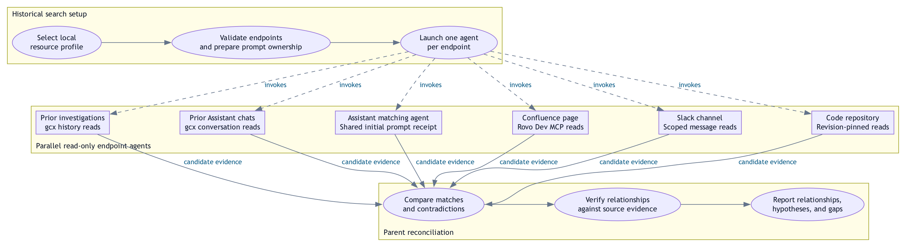

# Rhyming incident search

<picture>
  <source media="(prefers-color-scheme: dark)" srcset="DIAGRAM-rhyming-incident-search-dark.png">
  
</picture>

The profile supplies the endpoint inventory; the five boxes illustrate supported kinds, not
mandatory integrations. Instantiate one agent for every configured endpoint, including multiple
endpoints of the same kind. Independent queries launch in parallel capacity waves; a disabled
parent fan-out or unavailable delegation is recorded explicitly. Children receive identical
investigation questions, environment and incident/historical windows with an explicit timezone.

Solid arrows show handoffs; dashed arrows show skill invocation. Ovals identify activities;
boxes identify endpoint agents. The parent verifies material claims against retrievable
sources. Results distinguish evidence-backed relationships, hypotheses, no matches within the
searched scope, and unavailable endpoints. Similarity alone never proves a shared root cause.
History reads send no new Grafana Assistant prompts. No child mutates, acknowledges, messages
or publishes. This is the documented skill workflow, not evidence of a live investigation.

Source: [Rhyming Incident Search](../skills/rhyming-incident-search/SKILL.md),
[endpoint schema](../skills/profile-manager/references/profile-store.md#rhyming-endpoints).
Visual reference: [Per-store fan-out](DIAGRAM-per-store-fan-out.dot).

Editable [Graphviz source](DIAGRAM-rhyming-incident-search.dot),
[adaptive SVG](DIAGRAM-rhyming-incident-search.svg), explicit
[light SVG](DIAGRAM-rhyming-incident-search-light.svg) /
[dark SVG](DIAGRAM-rhyming-incident-search-dark.svg), and
[light PNG](DIAGRAM-rhyming-incident-search-light.png) /
[dark PNG](DIAGRAM-rhyming-incident-search-dark.png) are included.
Regenerate with `bash scripts/render-workflow-diagram.sh` from the repository root.
The renderer derives both palettes from the canonical source and checks SVG overlaps.

## Assistant matching integration

The explicit `grafana-assistant-search` endpoint prepares the matching request before an
Assistant initial prompt. Compatible context/scope/windows share one execution owner and receipt;
every configured endpoint retains its own child and manifest row. Disabled Assistant submits no
prompt while history-only reads and the direct investigation continue. An already-sent prompt
cannot retroactively include matching; no automatic duplicate is submitted. Assistant output is
leads until the parent verifies material source evidence. See
[Assistant matching](../skills/rhyming-incident-search/references/assistant-search.md).
