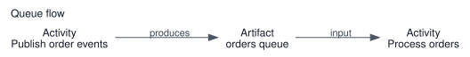

# Queue flow review

## Order processing path

<picture>
  <source media="(prefers-color-scheme: dark)" srcset="../diagrams/queue-flow-dark.svg">
  
</picture>

*Figure 1. Queue flow. Solid arrows are handoffs; labels name the relationship.*

Order events pass through one queue before processing. Source: diagrams/queue-flow.dot.
