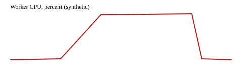
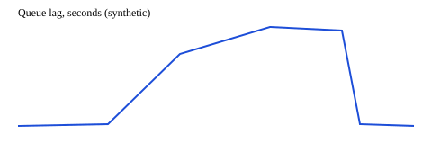

# Order queue lag investigation

Synthetic fixture, not production findings. Report formats: Markdown only. Status: partial.

## Continuation record

Coverage: recorded requests Q1-Q4. Entries are ordered; timestamps were not retained.

### Q1 — Why did queue lag rise?

**User:** explain the lag alert. **Agent:** lag rose while worker CPU was saturated; cause not yet identified.

### Q2 — Is it the retry loop?

**User:** check the retry loop. **Agent:** source shows failed jobs are resubmitted without backoff; whether that path ran is unverified.

### Q3 — Did the restart fix it?

**User:** did the restart help? **Agent:** lag fell after the single observed restart; one observation is not proof of a fix.

### Q4 — Propose a fix

**User:** what should change? **Agent:** proposed a bounded retry with backoff; not implemented.

## Handoff inventory

- [Saved samples](../../evidence/samples.json): local only, recipient access unverified.
- Source snapshot at synthetic revision r12.

## Worker CPU during the lag

Worker CPU held near 95% from 10:20 to 10:58 UTC and fell at the 10:58 restart. [E2](#E2)

**Figure 1.** Worker CPU, one-minute samples, 10:00-11:10 UTC. Synthetic data. Source: [E2](#E2).

## Queue lag

Queue lag rose from under 5 s to about 110 s over the same window and recovered within two minutes of the restart. [E1](#E1)

**Figure 2.** Queue lag, one-minute samples, 10:00-11:10 UTC. Synthetic data. Source: [E1](#E1).

## Source analysis

At revision r12 the worker resubmits a failed job immediately, with no retry limit. This is a code-supported candidate for the CPU saturation; the deployed revision was not mapped to r12, so it is not a verified cause. [E3](#E3)

## Proposed fix

Bound retries to five attempts with exponential backoff. Proposed, not implemented; it needs the deployed revision mapped to r12 and a load test. Restarting the workers is a stopgap observed once. [E2](#E2) [E3](#E3)

## Evidence index

Source: synthetic repository `orders-worker` at revision r12; samples 10:00-11:10 UTC; read-only; deployed revision untested.

- E1 - Queue lag samples, `evidence/samples.json`, series `lag_seconds`.
- E2 - Worker CPU samples, `evidence/samples.json`, series `cpu_percent`.
- E3 - `worker/retry.py`, lines 40-58, revision r12.
