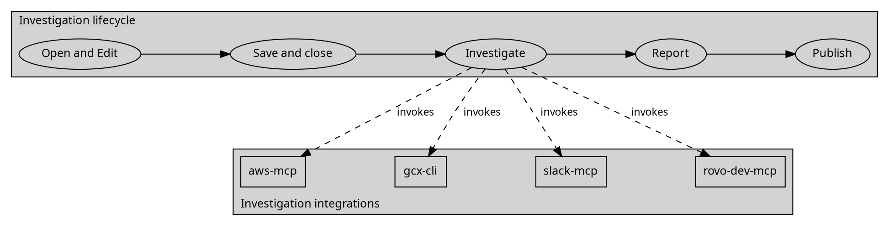

# Diagramming Style Guide

Use clear labels, deliberate spacing, and restrained color to explain relationships. This guide
is portable: copy it into another project and use the examples in any working directory. It
requires no particular repository, naming tool, template, external image, or hosted service.

## Visual rules

- Prefer plain text labels. Use wording, whitespace, alignment, and typographic hierarchy for
  emphasis. Do not add decorative boxes, pills, shaded panels, filled clusters, or opaque
  backgrounds behind edge labels merely to highlight text. When the user explicitly asks
  to match a supplied workflow reference, use the scoped
  [lifecycle with integration branches](#lifecycle-with-integration-branches) pattern below.
- Keep minimal structural outlines when they carry meaning, such as an ER table boundary.
  Use the canvas color or transparency inside them in both modes; white backplates are not
  acceptable in dark mode. Explain meaningful shapes in a legend;
  never invent a group, relationship, or dependency to improve the composition.
- Choose one dominant reading direction: left to right for a short process, top to bottom
  for a hierarchy or a narrow page. Align peers, leave space between branches, and keep edges
  clear of labels. Split crowded views instead of shrinking their text.
- Use concise node labels and action words on directed edges, such as `reads`, `writes`,
  `calls`, or `produces`. Preserve the direction and meaning of every relationship.
- Use Trebuchet MS when available, with Arial, Helvetica, or an available sans-serif fallback.
  Font substitution is acceptable; inspect the resulting line breaks and spacing. Keep labels
  readable at the actual delivery size, including PDF page width.
- Use color as reinforcement. Text, notation, and captions must still explain the diagram
  without color. Identify current and proposed views clearly; explain inferences in adjacent prose.

## Edge length and overlap control

Edges carry notation of their own: arrowheads, and in ER views stacked endpoint marks such as
crow's-foot circles, bars, and forks. A too-short edge crushes that notation against the shapes
it connects, so marks merge into outlines and cardinality becomes unreadable. Guard against
this at layout time and verify it on the render:

- Reserve enough run between connected shapes for every mark on the edge. In Graphviz, raise
  `ranksep`/`nodesep`, or set `minlen=2` (or more) on the specific short edge; compact values
  near `0.4` that suit plain flowcharts are usually too tight for ER edges, which stack two
  endpoint marks on one line — start ER views at `ranksep=0.7` or higher and confirm visually.
  In Mermaid, raise `rankSpacing`/`nodeSpacing` in the flowchart or ER configuration.
- Keep both endpoint marks fully visible in the open space between the two shapes, not
  touching, crossing, or merged into either outline or a nearby title row. If a mark lands on
  a border, lengthen the edge or move the node; do not shrink the mark or hide it.
- Keep labels clear of edge shafts, arrowheads, node outlines, and other labels. Offset the
  label (Graphviz `xlabel`, `labeldistance`/`labelangle`, or added spacing; Mermaid label
  offsets via `themeCSS`), reroute the edge, or lengthen it. Never resolve an overlap with an
  opaque backplate behind the label or by shrinking text below the readable delivery size.
- When spacing fixes crowd the layout instead, split the view. A longer, clearer diagram set
  beats one canvas with colliding notation.
- Inspect the rendered image in both themes at delivery size for short edges, clipped or
  merged endpoint marks, and label collisions. Layout settings in the source do not prove
  clearance; only the render does.

### Automated overlap checks

The bundled checker, `scripts/check_diagram_overlaps.py`, validates these rules on rendered
Graphviz SVG output (both themes render from the same geometry, so checking one theme's SVG
covers the layout; theme colors still need the visual pass):

```sh
python3 scripts/check_diagram_overlaps.py path/to/diagram-light.svg path/to/diagram-dark.svg
```

It fails (exit 1) and names the offending element pair when a label sits within the
clearance distance (default 2px) of an edge line, arrowhead, endpoint mark, shape outline,
or another label; when shape outlines or marks collide beyond boundary contact; or when an
edge's sampled run cannot fit the merged along-edge extent of its own notation plus
clearance. Pairs that meet by construction are exempt from the clearance distance but not
from actual penetration: an edge necessarily reaches the text of its endpoint nodes in
plain-label styling, and an edge's own label sits beside its own line. `--clearance`,
`--min-edge-run`, `--touch-tolerance`, and `--char-width-ratio` tune the thresholds;
`--json` emits a machine-readable report.

Known limits: it reads Graphviz `-Tsvg` structure only (Mermaid SVGs are rejected, not
guessed at), and text extents are estimated from font size and character count (default
ratio 0.48, calibrated for Trebuchet MS/Arial mixed case). Treat a pass as a spacing
regression gate alongside — never instead of — the visual inspection of both themes.

The checker's own test suite lives in `tests/test_check_diagram_overlaps.py`. It covers a
clean diagram passing, each defect class being detected (label on line, label on shape,
label on arrowhead, colliding labels, colliding shapes, mark penetration versus allowed
boundary touch, short and notation-crowded edges), the attachment exemptions, invisible
layout-edge handling, and — when Graphviz is installed — an end-to-end render proving a
spaced ER edge passes while a crammed one fails:

```sh
python3 -m unittest discover -s tests   # from the skill folder
```

Run it after any change to the checker or its thresholds.

## Titles inside diagrams

Use sentence-case titles inside diagrams, preserving domain acronyms, and set their font size
to the same readable size as the main body labels. For example, use `Current source flow`
instead of a large all-capital title. Establish hierarchy with aligned placement and a clear
gap between the title and diagram body. Do not shrink a title below readable body text to
make it unobtrusive. Titles remain subject to the rule keeping caveats outside drawings.

In Graphviz, set the graph's `fontsize` to the main node/body `fontsize`. Use label spacing,
such as a trailing `\n`, and the graph's padding to separate the title from the body. In
Mermaid flowchart and ER renders, the title text elements use `.flowchartTitleText` and
`.erDiagramTitleText`. Match their size to the body font through `themeCSS`; for a 16px body,
use `font-size: 16px !important; font-weight: 400 !important;` on those selectors. Retain
enough diagram padding for clear spacing. Inspect the actual title element when using another
diagram type or renderer version rather than assuming these selectors apply everywhere.

Apply the same title size, case, alignment, and spacing in both themes and every exported
format, including titles embedded in SVG, PNG, or PDF. Validate at the delivered size that
the title and body are equally readable and do not collide. This rule applies to titles
inside drawings; surrounding Markdown or PDF report section headings retain their own
document hierarchy.

## Information hierarchy and context

Apply these principles to make technical information easier to understand, not to minimize
the number of marks regardless of meaning:

- Remove nonessential ink while retaining useful structure. ER table boundaries, keys,
  crow's feet, optionality marks, and relationship labels carry information; keep evidence
  references in adjacent text. Do not erase meaning merely to achieve a sparse appearance.
  Keep backgrounds clean and use the canvas-matching structural fills described above.
- Start with neutral text and lines for routine structure. Use stronger accents for a defined
  status, important change, or consistent semantic role, and explain that role. The palette's
  edge-word accent identifies relationship actions; it does not imply a warning or outcome.
  Reinforce status and distinctions with text or line style so color is never the only signal.
- Check foreground/background contrast, text size, and line visibility in each rendered theme.
  A hex value alone cannot establish AA compliance; evaluate its actual use and background.
  Do not carry a light-theme threshold color into dark mode without checking it there.
- Present an overview before detailed views when a subject needs several diagrams. Let readers
  see the system or question first, then inspect relevant flows, structures, and dependencies.
  Use consistent identifiers to connect the views; do not force all detail into one canvas.
- Group related views through headings, alignment, and whitespace. Use available width for
  useful side-by-side comparisons while preserving readable labels and a clear reading order.
  Keep repeated entities in comparable positions where practical; preserve layout between
  themes and avoid unnecessary rearrangement between comparable versions. Grouping must reflect
  the subject, not invent a relationship or decorative enclosure.
- Place scope, assumptions, exclusions, legends, and evidence in an adjacent caption or prose
  outside the drawing. Retain essential edge labels and multiplicity inside the diagram.
  Explain what readers are comparing and what they cannot infer; preserve this context in
  static exports rather than relying only on a hover description.

## Workflow views

Use separate views to answer separate questions. An overview explains what happens and
which artifacts pass between activities; a routing view explains which skills or components
perform the work. A review/merge view explains actual gates and their outcomes. Repeating a
stable activity or artifact name across views connects them without crowding one canvas.

| View | Show | Keep in a separate view or adjacent prose |
| --- | --- | --- |
| Activity/artifact overview | Entry points, main activities, named inputs and outputs, terminal outcome | Internal skill fan-out and detailed review criteria |
| Skill routing | Invoking activity, selected skill, delegation/routing edges, produced artifact | An implied timeline between independent routes |
| Lifecycle with integrations | Short lifecycle plus a small set of explicitly requested invocation branches | Artifact detail, conditional integration selection, and authorization conditions |
| Review/merge gates | Verified check, pass/fail or retry path, required merge/deployment verification | A claim that review dimensions execute sequentially |

Use these conventions when adapting a real workflow:

- Distinguish **activity**, **artifact**, and **skill/component** roles in plain labels, for
  example `Activity` above `Review evidence`. File paths belong to artifacts; preserve the
  actual identity and approved destination. Do not import another project's lifecycle or
  filename pattern just because its layout is useful.
- Label relationships by meaning: an artifact is `input` to an activity, an activity
  `produces` an artifact, and an activity `invokes` a skill. Use `routes` for dispatch, `returns`
  for returned evidence, and `informs` for a supporting relationship. Keep terms consistent
  across the diagram set. A skill invoked by another activity does not become its next stage.
- Reserve solid arrows for the main handoff path and, when useful, dashed arrows for skill
  invocation/routing. Explain the convention beside each view; dashed lines must not silently
  mean uncertainty in one view and invocation in another. Preserve the SQL dependency
  profile's own dashed-action convention rather than treating line styles as universal.
- Keep the main path in one reading direction and arrange independent routes as peers.
  Graphviz `rank=same`, weights, ports, and invisible edges may stabilize alignment, but
  layout-only edges must be invisible and must not manufacture a dependency. Do not connect
  correctness, readability, architecture, security, and performance in a chain unless the
  actual process requires that order; show review criteria as peers or adjacent prose.
- Draw a gate only when it controls continuation. Separate command completion, evidence
  verification, merge, and deployment acceptance when the workflow distinguishes them.
  Show supported retry/stop paths; describe missing evidence beside the diagram. Do not copy
  an outcome such as deployment into an investigation that only produces reports.
- Group by real responsibility through headings, whitespace, and aligned peer rows. The
  default examples retain plain labels. Use the scoped pattern below when matching an
  explicitly requested reference with meaningful activity shapes and responsibility groups.

Adapt [workflow-overview.dot](../assets/workflow-overview.dot) and
[workflow-routing.dot](../assets/workflow-routing.dot) as a pair. The fictional overview
shows a task feeding evidence review, which produces findings for report writing. The routing
view expands the review activity into source-reading and finding-writing responsibilities.
Solid edges carry handoffs; dashed edges show invocations. These are teaching examples, not
claims about a particular system, exhaustive callers, parallel execution, or ordering between
the two invoked skills. Retain those qualifications beside any published example render.

Render both examples with the light/dark functions below, using the same commands as the
report examples and substituting `workflow-overview workflow-routing` for the example names.
Check overlap, theme parity, labels, and delivery-size readability in both views. As with all
diagram sets, one canonical source generates both themes; primary Markdown presentation uses
verified host-aware rendering or paired themed images with adjacent captions.

### Lifecycle with integration branches

Use this compact view when the reader needs to understand both **what happens next** and
**what one activity invokes**, and the user requests that combination or supplies a visual
model. A lifecycle alone hides the integrations; a detailed artifact graph can bury the
main path. A vertical stack of integration nodes can also turn a short process into a tall,
mostly empty canvas. Keep larger fan-outs in a separate routing view.

Inspect the supplied rendered reference as well as its editable source. Matching only
`rankdir` or the topology does not reproduce its visual language. Identify the features
the user is asking to retain: activity shapes, component shapes, group boundaries, relative
placement, spacing, typography, and palette. For this explicitly requested mode, oval
activities, boxed integrations, and restrained shaded responsibility groups are appropriate;
the plain-label defaults continue to apply to other diagrams. Do not copy the reference's
project-specific lifecycle, branding, or unsupported relationships.

Arrange the lifecycle as a horizontal row with solid handoff arrows. Put the integration
peers in a second horizontal group below it, with dashed arrows from the invoking activity,
each labeled `invokes`. Keep exact user-selected labels, capitalization, and arrow direction.
For example, an investigation can show:



Here `rankdir=TB` separates the two rows while `rank=same` keeps each row horizontal.
Invisible edges stabilize peer placement only; they convey no integration order or
parallel-execution guarantee. Move a group heading below the nodes when incoming arrows
would cross it. Check the render rather than assuming a cluster protects its heading.

Keep artifact details and qualifications in adjacent prose: the example's stages produce
a draft task, saved task, findings/evidence, and Markdown/PDF reports. Integrations are
selected as needed for the task. `Report → Publish` depicts a possible authorized handoff;
it neither authorizes publication nor makes it automatic. Use a different lifecycle when
the actual workflow differs.

Generate both themes from the same source and a committed renderer. For the reference-style
groups, a useful palette is light canvas `#ffffff`, group `#fffde7`, node `#ececff`, and dark
canvas `#0f172a`, group `#374151`, node `#1e293b`. Pair dark text `#f1f5f9`, node outlines
`#a5b4fc`, edges `#94a3b8`, and action labels `#a5f3fc`; inspect contrast on the actual fills.
These are mode-specific options, not changes to every diagram's palette. After even a label
or arrow edit, regenerate all delivered PNG/SVG variants, including any adaptive SVG, and
update captions and alt text. Preserve shape, label, edge, and geometry parity across themes;
visually inspect both and run the overlap checker. Where a repository approves binary assets
by path and hash, retain reviewed historical hashes as well as the new reviewed render so
full-history scans remain valid.

## Light and dark profiles

Support both profiles from the same diagram definition. Change the palette only: preserve
identifiers, labels, edges, direction, grouping, layout settings, and adjacent captions, evidence,
and scope notes.
Use light as the print/PDF default; supply dark exports for dark viewing contexts. A dark canvas
is a page background, not a highlight panel around selected text.

Prefer one committed canonical source per diagram, with the second theme produced at render
time by a committed mechanism the repository can rerun: shared external theme configurations
(as in the Mermaid example below), renderer palette flags (as in the Graphviz example below),
or a small committed script that maps the light palette to the dark palette before rendering.
A scripted derivation means the two themes cannot drift structurally. When separate per-theme
source files must exist — for example, a renderer that only reads embedded front matter —
treat the light file as canonical, propagate every structural change to the dark file in the
same edit, and before delivery diff the pair with palette, background, and theme lines
filtered out; any remaining difference is drift to resolve.

| Role | Light / print | Dark |
| --- | --- | --- |
| Canvas | `#ffffff` | `#0f172a` |
| Main text | `#0f172a` | `#f1f5f9` |
| Arrows and secondary text | `#475569` | `#94a3b8` |
| Meaningful structural outlines | `#6366f1` | `#a5b4fc` |
| Edge action words | `#0e7490` | `#67e8f9` |
| Label and cluster backgrounds | Transparent | Transparent |

Check both profiles on their actual canvas. Do not let a viewer place light text on a light
background or dark text on a dark background by dropping the intended canvas color.

## Mermaid example

The example uses one graph and two complete configuration files. Save the following editable
source as `diagram.mmd`; it is shown as text to avoid an unverified inline theme. The labels
illustrate a generic process, not a claim about a real system.

```text
flowchart LR
    source["Source material"] -->|informs| review["Review evidence"]
    review -->|produces| findings["Document findings"]
    classDef plain fill:none,stroke:none;
    class source,review,findings plain;
```

Save this as `theme-light.json`:

```json
{
  "theme": "base",
  "flowchart": {"htmlLabels": false, "curve": "linear", "nodeSpacing": 40, "rankSpacing": 70},
  "themeVariables": {
    "darkMode": false,
    "background": "#ffffff",
    "fontFamily": "\"Trebuchet MS\", Arial, Helvetica, sans-serif",
    "fontSize": "16px",
    "primaryColor": "#ffffff",
    "primaryTextColor": "#0f172a",
    "primaryBorderColor": "#6366f1",
    "textColor": "#0f172a",
    "lineColor": "#475569",
    "edgeLabelBackground": "transparent",
    "clusterBkg": "transparent",
    "clusterBorder": "transparent"
  },
  "themeCSS": ".edgeLabel rect, .labelBkg, .relationshipLabelBox { background: transparent !important; fill: none !important; } .edgeLabel, .edgeLabel p { background-color: transparent !important; } .edgeLabel text { fill: #0e7490 !important; transform: translateY(-14px); }"
}
```

Save this as `theme-dark.json`:

```json
{
  "theme": "base",
  "flowchart": {"htmlLabels": false, "curve": "linear", "nodeSpacing": 40, "rankSpacing": 70},
  "themeVariables": {
    "darkMode": true,
    "background": "#0f172a",
    "fontFamily": "\"Trebuchet MS\", Arial, Helvetica, sans-serif",
    "fontSize": "16px",
    "primaryColor": "#0f172a",
    "primaryTextColor": "#f1f5f9",
    "primaryBorderColor": "#a5b4fc",
    "textColor": "#f1f5f9",
    "lineColor": "#94a3b8",
    "edgeLabelBackground": "transparent",
    "clusterBkg": "transparent",
    "clusterBorder": "transparent"
  },
  "themeCSS": ".edgeLabel rect, .labelBkg, .relationshipLabelBox { background: transparent !important; fill: none !important; } .edgeLabel, .edgeLabel p { background-color: transparent !important; } .edgeLabel text { fill: #67e8f9 !important; transform: translateY(-14px); }"
}
```

With Mermaid CLI (`mmdc`) installed, run these commands in the directory containing the files.
For PDF, set both the diagram and page canvas and preserve print colors; the CLI background
option alone does not reliably set PDF pages.
The example commands were checked with Mermaid CLI 11.16.0. Verify your renderer's behavior.
The label offset keeps action words above these horizontal edges; inspect and adjust label
placement when adapting the example to a different layout.

```sh
mmdc --version
printf '%s\n' 'html, body { background: #ffffff !important; } * { -webkit-print-color-adjust: exact !important; print-color-adjust: exact !important; }' > page-light.css
printf '%s\n' 'html, body { background: #0f172a !important; } * { -webkit-print-color-adjust: exact !important; print-color-adjust: exact !important; }' > page-dark.css
mmdc -i diagram.mmd -c theme-light.json -b '#ffffff' -o diagram-light.svg
mmdc -i diagram.mmd -c theme-dark.json -b '#0f172a' -o diagram-dark.svg
mmdc -i diagram.mmd -c theme-light.json -b '#ffffff' -s 2 -o diagram-light.png
mmdc -i diagram.mmd -c theme-dark.json -b '#0f172a' -s 2 -o diagram-dark.png
mmdc -i diagram.mmd -c theme-light.json -C page-light.css -b '#ffffff' -f -o diagram-light.pdf
mmdc -i diagram.mmd -c theme-dark.json -C page-dark.css -b '#0f172a' -f -o diagram-dark.pdf
```

For native inline Markdown, a `mermaid` fence is appropriate only after verifying the same
document in both host themes. A viewer does not automatically load neighboring JSON files. If
it supports Mermaid configuration, supply the selected profile through that viewer's supported
configuration. Some hosts restrict overrides or do not switch Mermaid when the page theme
changes. A fixed light configuration displayed in dark mode fails acceptance. When automatic
theming is unavailable or unverified, use the primary paired-image pattern below and retain
the editable graph as non-rendering source. JSON profiles and successful standalone exports
do not prove inline theme behavior.

## Graphviz example

Save this palette-independent definition as `diagram.dot`. Plaintext nodes have no decorative
outlines or fill. Keep any palette overrides out of this definition so the two profiles use
identical geometry and content.


With Graphviz (`dot`) installed, export both palettes. The shell functions below are complete
and need no project utility. They apply the same palette to each output format. The commands
were checked with Graphviz 16.1.0; available output renderers depend on the installation.

```sh
dot -V
render_light() {
  dot -Gbgcolor='#ffffff' -Gfontcolor='#0f172a' \
    -Nfontcolor='#0f172a' -Ncolor='#6366f1' \
    -Ecolor='#475569' -Efontcolor='#0e7490' "$@"
}
render_dark() {
  dot -Gbgcolor='#0f172a' -Gfontcolor='#f1f5f9' \
    -Nfontcolor='#f1f5f9' -Ncolor='#a5b4fc' \
    -Ecolor='#94a3b8' -Efontcolor='#67e8f9' "$@"
}
render_light -Tsvg -o diagram-light.svg diagram.dot
render_dark -Tsvg -o diagram-dark.svg diagram.dot
render_light -Tpng -Gdpi=200 -o diagram-light.png diagram.dot
render_dark -Tpng -Gdpi=200 -o diagram-dark.png diagram.dot
render_light -Tpdf -o diagram-light.pdf diagram.dot
render_dark -Tpdf -o diagram-dark.pdf diagram.dot
```

Run the Mermaid and Graphviz examples in separate directories: their output names intentionally
match. For an ER table, use a minimal table outline and row separators where useful, without a
shaded heading or cell fill. Avoid blanket shape-removal rules that would erase meaningful ER
structure. For a true grouping, prefer a plain heading and spacing; make any necessary boundary
minimal and explain its meaning.

## Grafana data and interactive graphs

Enrich data-based findings with relevant graphs from Grafana CLI when access and data are
available within the task's authorized scope. Prefer a graph that answers the investigation
question: a time series for trends, an aligned comparison for related metrics, a distribution
for variation, or a trace waterfall for a selected request. Keep architecture/dependency
diagrams alongside measured behavior when both help; correlation does not establish a
dependency, execution order, or root cause.

- Resolve the explicit Grafana instance/context and organization. Use the caller's supported
  authentication workflow, opening browser sign-in and waiting when needed. Discover the
  available gcx commands, datasource UIDs/types, and actual query capabilities; do not silently
  switch instances or treat catalog visibility as successful data access.
- Query bounded data with the selected resource filters, exact time window/timezone, and
  suitable step or aggregation. Preserve units, timestamps, missing intervals, series
  selection, and source-supported thresholds. Compare compatible windows and resolutions;
  do not invent points, interpolate unexplained gaps, or equate missing data with zero.
- Link the graph to short evidence identifiers and record the instance, datasource/resource
  IDs, query or panel identity, variables, window, step/aggregation, observation time, and
  limits in the evidence index. Retain the permitted query result and reproducible plotting
  source in caller-resolved paths. Keep credentials and unnecessary sensitive payloads out.
- When the current host supports interactive graphs, create the requested interactive
  graph/view from the verified query data. Verify that it uses the intended
  query, datasource, and time range. Test visible rendering and relevant interactions,
  such as time selection, zoom, series selection, or trace filtering; structured content
  or HTML retrieval alone does not prove an interactive view works.
- Provide a readable static representation for every requested static deliverable. Use a
  supported export or render the same saved query data with standard plotting tools, with
  the same graph identifier, meaning, units, window, and adjacent evidence/captions. Include
  it in the diagram inventory and matching Markdown/PDF outputs. A link to an interactive view is not a
  replacement for the static graph; a PNG/PDF cannot preserve hover, zoom, or filtering.
- Apply the light/dark and delivery-size checks to measured-data graphs too. Keep meaningful
  axes, ticks, units, and series labels; distinguish lines through labels or styles as well
  as color. Put data coverage, sampling limits, uncertainty, and other caveats beside the
  graph, preserving them across interactive and static delivery. Do not replace an accurate
  axis or scale with decorative grouping or an invented visual maximum.
- If gcx, a datasource, or an interactive view is unavailable or denied, record the exact limitation
  beside the affected finding. Use authorized saved data or an available static view and
  keep any unverified interaction claim explicit. Do not fabricate telemetry, broaden
  permissions, change monitoring resources, or block unrelated diagrams solely to add a
  graph. Retain existing investigation-entry requirements when using gcx or other tools.

Grafana enrichment is optional to this portable package. Installing or copying the
diagramming skill does not itself require a Grafana account, sibling skill, server, or host
with interactive graph support, and it grants no additional resource or publication authority.

## Report graph profile

Use the bundled palette-independent examples as the visual starting point for report graphs.
Keep the shared typography, plain flow labels, restrained table outlines, and light/dark
profiles above. Align related peer paths side by side where this makes comparison easier;
split a view when its text would otherwise become unreadable at the delivered page width.
Layout is not evidence: preserve the investigated relationships and current/proposed identity.

### ER relationships

Adapt [report-er.dot](../assets/report-er.dot). Center the bold entity title over two columns:
put `PK`, `FK`, and `UQ` markers in the narrow left column and field names, nullability, or
composite-key members in the right. Keep the table and title unfilled. A borderless outer
table with padding reserves space between the structural outline and endpoint marks.

Use crow's-foot marks at both ends instead of replacing them with floating numeric labels.
For `parent -> child`, `arrowtail` describes how many parents one child may reference;
`arrowhead` describes how many children one parent may have. Set `dir=both` so both render.
The profile uses these combinations of [Graphviz arrow shapes](https://graphviz.org/doc/info/arrows.html):

| Cardinality at an endpoint | Mark | Graphviz value |
| --- | --- | --- |
| Zero or one | Circle and bar | `teeodot` |
| Exactly one | Double bar | `teetee` |
| Zero or more | Circle and fork | `crowodot` |
| One or more | Bar and fork | `crowtee` |

Verify each endpoint from the applicable schema and constraints. A nullable FK permits zero
parents; a non-null FK requires one. A non-unique FK permits many children, but does not require
any child to exist. A unique FK may cap that count at one. Use `1..*` only when inspected
constraints or an explicitly scoped domain rule require at least one child. Do not infer
cardinality from field names or sample row counts. Explain conditional rules beside the graph.

The fictional example defines an optional team and a required category for each record;
each team and category may have zero or more records. `ExternalKey` is unique. These example
constraints are not findings about any repository. In a report, replace this annotation with
the actual schema scope, evidence, and omitted relationships. Explain the endpoint notation
in the caption or an essential-notation legend.

### SQL dependencies

Adapt [report-sql-dependencies.dot](../assets/report-sql-dependencies.dot). Prefix plain labels
with `Procedure`, `Function`, or `Table`, and use dashed directional arrows labeled with the
observed action: `reads`, `writes`, or `calls`. Arrange independent read and write paths in
parallel columns where useful. Any layout-only edges must be invisible; do not create a
dependency to align nodes. Dashed lines identify SQL dependencies in this profile, not
uncertainty. State evidence gaps beside the graph and keep proposed behavior clearly identified.

The fictional example shows a read procedure calling a function that reads records, and a
write procedure calling another procedure that writes records. It does not establish order
between the two paths or a shared transaction. Both `Record` labels represent the same table,
repeated to keep the paths legible. Replace its symbols and edges with traced
dependencies; keep SQL access separate from the ER view.

### Render and verify the examples

Run from a scratch output directory after defining `render_light` and `render_dark` above.
Set `DIAGRAM_SKILL` to the absolute path of this copied skill folder. The examples need no
sibling checkout or report assets. Use caller-resolved destinations for real report outputs.

```sh
DIAGRAM_SKILL='/absolute/path/to/diagramming-style'
for example in report-er report-sql-dependencies; do
  render_light -Tsvg -o "$example-light.svg" "$DIAGRAM_SKILL/assets/$example.dot"
  render_dark -Tsvg -o "$example-dark.svg" "$DIAGRAM_SKILL/assets/$example.dot"
  render_light -Tpng -Gdpi=200 -o "$example-light.png" "$DIAGRAM_SKILL/assets/$example.dot"
  render_dark -Tpng -Gdpi=200 -o "$example-dark.png" "$DIAGRAM_SKILL/assets/$example.dot"
  python3 "$DIAGRAM_SKILL/scripts/check_diagram_overlaps.py" \
    "$example-light.svg" "$example-dark.svg"
done
```

Inspect both palettes for the aligned key columns, visible endpoint marks, title and body
contrast, and labels clear of dashed lines. Preserve the canonical source and add adapted
graphs to the report inventory. The Markdown and format-consistency checks below still apply;
these standalone renders do not establish delivery-host acceptance.

## Caveats outside drawings

Keep all caveats in adjacent captions or prose. Rendered titles, subtitles, nodes, edges,
notes, and legends must contain no limitations, assumptions, exclusions, uncertainty, validation
status, or scope qualifications. For example, explanations that functions are not ER entities
or deployment was not verified belong beside the diagram, as does a disclaimer such as
"No clinical mapping prescribed". This applies to every diagram, theme, renderer, and delivered
format.

Preserve essential domain labels, current/proposed identity, keys, nullability, cardinality,
and relationship direction. Moving caveats is a presentation change, not permission to
strengthen claims or erase schema meaning. Explain conditional constraints beside the diagram;
an adjacent caption may explicitly scope a view to the schema where its key or uniqueness
annotations are true, such as operational rather than archive definitions. Keep those truthful
annotations, and omit one only if it remains misleading under the stated scope. Preserve the
complete condition in adjacent text; never turn a scoped constraint into a universal claim.

Keep only essential notation in any legend inside the drawing. Put qualifications, scope,
assumptions, and evidence beside it, and preserve them in every format. Check the actual
rendered text as well as source labels; removing a source note does not prove all exported
versions are free of caveats.

## Data, dependencies, and captions

For ER views, show verified keys, foreign-key targets, cardinality, nullability, and relevant
uniqueness, subject to the conditional-constraint rule above. Distinguish physical tables from
role aliases and entity assignments from dictionary mappings. Explain selected columns, omitted
relationships, conditional constraints, and migration scope in adjacent captions or prose.
A source declaration does not prove the deployed schema; state that limitation outside the drawing.

Put SQL functions and procedures in a separate dependency view with explicit `reads`, `writes`,
and `calls` edges. These edges are not foreign keys and do not imply execution order or
transaction boundaries. A legend inside the diagram may explain abbreviations or multiplicity
notation.
Put exceptions, source evidence, and unverified relationships in adjacent captions or prose;
retain clear current/proposed identity. Keep these qualifications visible outside the drawing
in every delivered version, not solely in source comments.

## Markdown presentation and format consistency

Maintain one canonical diagram definition and a complete inventory of diagram identifiers,
captions, evidence references, scope notes, themes, and deliverable formats. Every supported
report format must contain every inventoried diagram, including ER and SQL dependency views.
Separate renderer definitions, if needed, must preserve the same semantics. Layout and file
bytes may differ across renderers and formats.

Use native inline diagrams as the primary presentation only when their theme behavior has been
verified in the delivery host. Otherwise use paired themed images as the primary diagram, as
in this pattern. On a host that permits HTML `picture` and media queries, it selects dark for a
dark color-scheme preference and uses light by default. Bundle both assets and verify their
selection in the same Markdown document under both host themes. Do not hide the themed images
only in a collapsed fallback beneath a fixed light inline diagram. This pattern does not make
an inline Mermaid renderer switch themes.

```html
<picture>
  <source media="(prefers-color-scheme: dark)" srcset="diagram-dark.png">
  
</picture>
```

Retain the editable Mermaid definition as a source link or in a collapsed `details` element
using a `text` fence or escaped `pre` content, rather than a second rendered `mermaid` fence.
For example, this source disclosure can accompany the primary image:

```html
<details>
  <summary>Editable Mermaid source</summary>
  <pre>flowchart LR
    source["Source material"] --&gt;|informs| review["Review evidence"]
    review --&gt;|produces| findings["Document findings"]
    classDef plain fill:none,stroke:none;
    class source,review,findings plain;</pre>
</details>
```

Provide the diagram identifier, caption, evidence, and caveats immediately beside the diagram.
If the host strips HTML, blocks bundled assets, or ignores the media query, use its supported
image attachment or embedding mechanism and provide explicitly labeled light and dark options.
Relative links alone do not prove visibility. Avoid duplicating both the live diagram and its
source disclosure in exported PDFs; include one complete, readable representation per inventory
entry. Do not claim automatic theme support if the delivery host could not be verified.

After a change, regenerate all supported formats and both themes from the canonical source.
Open the same rendered Markdown in light and dark mode and inspect exported SVG/PNG/PDF at the
size readers will use. Verify the selected image asset where the host exposes it. Standalone
image checks do not replace the Markdown check.
Check the complete inventory, labels, edge direction, captions, evidence, legends, and caveats.
Verify that no caveat remains in rendered diagram text, including titles, subtitles, nodes,
edges, notes, and legends, and that every relocated qualification remains in adjacent text.
Count primary rendered diagrams against the inventory; editable source fences and links do
not count as rendered diagrams, regardless of their fence language.
Inspect both profiles for text contrast, clipping, crossings, font substitution, missing canvas
colors, default node/cluster/edge-label backgrounds, short edges whose arrowheads or endpoint
marks collide with shape outlines, and labels overlapping edges, shapes, or other labels. Parsing, file existence, and link
counts do not establish visual quality or complete delivery. Record the renderers and versions
used, and state any delivery host or format that could not be checked.

## Reference provenance

The workflow-view concepts were checked against the local `agent-tasks` checkout at
commit `ceda802460c60a619d78960f4df23a63b12ebddd`, with no working changes, on
November 2, 2026:

- [HOW-A-TASK-FLOWS.dot](https://github.com/orenlion1/agent-tasks/blob/ceda802460c60a619d78960f4df23a63b12ebddd/docs/diagrams/HOW-A-TASK-FLOWS.dot)
  separates the main lifecycle from the skills it routes into.
- [TASK-FLOW-DIAGRAM.dot](https://github.com/orenlion1/agent-tasks/blob/ceda802460c60a619d78960f4df23a63b12ebddd/docs/diagrams/TASK-FLOW-DIAGRAM.dot)
  makes activity/artifact handoffs and invocation/output edges explicit, and uses rank,
  weight, ports, and invisible edges to arrange related paths.
- [pull-request-flow-diagram.md](https://github.com/orenlion1/agent-tasks/blob/ceda802460c60a619d78960f4df23a63b12ebddd/docs/diagrams/pull-request-flow-diagram.md)
  separates merge routing from five review dimensions. Its drawn chain does not establish
  that those dimensions must execute sequentially; the guidance above avoids that inference.
- [render-diagrams.sh](https://github.com/orenlion1/agent-tasks/blob/ceda802460c60a619d78960f4df23a63b12ebddd/docs/diagrams/render-diagrams.sh)
  derives paired theme exports from committed Graphviz sources; the accompanying Markdown
  documents source ownership and regeneration, and uses primary themed images.

The portable examples are adaptations, not copies of that repository's execution contract.
No sibling checkout is required to use them. The provenance below describes earlier supplied
references; its screenshot hash is historical, not a digest of the inspected checkout above.

The user-supplied Agent Tasks image `TASK-FLOW-DIAGRAM-dark.png` inspired the dark palette,
typography, spacing, and colored action words. The accompanying `TASK-FLOW-DIAGRAM.md` uses
paired images in a primary `picture` element, the model for the Markdown pattern above.
The image's SHA-256 is
`5154ef122819f670847451f9e34a82b3ba1ea0067aea7b41fc894e4e48dc8b91`.
The same Agent Tasks diagram set keeps one committed light Graphviz source per diagram and
derives the dark rendition with a committed palette-substitution script (`render-diagrams.sh`),
plus shared per-theme Mermaid configuration files; that practice is the model for the
single-canonical-source derivation guidance above.
The reference also contains shapes and filled panels; this adaptation follows the plain-label
rules above and is not an exact reproduction. The reference image is not bundled or required
to use this guide.

The supplied one-page document `The Tufte Aesthetic for Grafana Dashboard Design.pdf`
informed the information-hierarchy and context principles above. Its SHA-256 is
`256ecbb65a691c83100851ce1331639ff7d8fff00098a3f0786d75f75f92fa90`.
This is an adaptation of the supplied document, not independent verification of Tufte's work
or Grafana standards. Its numbered references 1-6 have no corresponding sources in the
supplied file. Its Singlestat, Bar Gauge, Retro LCD/Basic, exact goal-threshold colors, and
dashboard row-placement recommendations are source-specific guidance, not universal diagram
rules. Its statement about a particular red meeting AA does not establish contrast compliance
for arbitrary backgrounds, text sizes, or themes. The PDF is not required to use this package.
