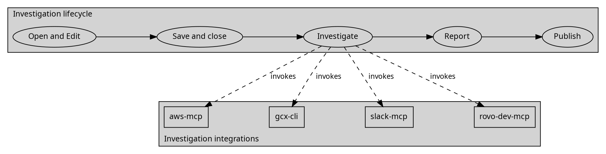

# Workflow Views

Part of the [Diagramming Style Guide](diagramming-style.md); its visual, theme, caveat, and
delivery rules apply here.

Use separate views to answer separate questions. Repeating a stable activity or artifact name
across views connects them without crowding one canvas.

| View | Show | Keep in a separate view or adjacent prose |
| --- | --- | --- |
| Activity/artifact overview | Entry points, main activities, named inputs and outputs, terminal outcome | Internal skill fan-out and detailed review criteria |
| Skill routing | Invoking activity, selected skill, delegation/routing edges, produced artifact | An implied timeline between independent routes |
| Lifecycle with integrations | Short lifecycle plus a small set of explicitly requested invocation branches | Artifact detail, conditional integration selection, and authorization conditions |
| Review/merge gates | Verified check, pass/fail or retry path, required merge/deployment verification | A claim that review dimensions execute sequentially |

Use these conventions when adapting a real workflow:

- Distinguish **activity**, **artifact**, and **skill/component** roles in plain labels, for
  example `Activity` above `Review evidence`. File paths belong to artifacts; preserve the
  actual identity and approved destination. Do not import another project's lifecycle or
  filename pattern just because its layout is useful.
- Label relationships by meaning: an artifact is `input` to an activity, an activity
  `produces` an artifact, and an activity `invokes` a skill. Use `routes` for dispatch, `returns`
  for returned evidence, and `informs` for a supporting relationship. Keep terms consistent
  across the diagram set. A skill invoked by another activity does not become its next stage.
- Reserve solid arrows for the main handoff path and, when useful, dashed arrows for skill
  invocation/routing. Explain the convention beside each view; dashed lines must not silently
  mean uncertainty in one view and invocation in another. Preserve the SQL dependency
  profile's own dashed-action convention rather than treating line styles as universal.
- Keep the main path in one reading direction and arrange independent routes as peers.
  Graphviz `rank=same`, weights, ports, and invisible edges may stabilize alignment, but
  layout-only edges must be invisible and must not manufacture a dependency. Do not connect
  correctness, readability, architecture, security, and performance in a chain unless the
  actual process requires that order; show review criteria as peers or adjacent prose.
- Draw a gate only when it controls continuation. Separate command completion, evidence
  verification, merge, and deployment acceptance when the workflow distinguishes them.
  Show supported retry/stop paths; describe missing evidence beside the diagram. Do not copy
  an outcome such as deployment into an investigation that only produces reports.
- Group by real responsibility through headings, whitespace, and aligned peer rows. The
  default examples retain plain labels. Use the scoped pattern below when matching an
  explicitly requested reference with meaningful activity shapes and responsibility groups.

Adapt [workflow-overview.dot](../assets/workflow-overview.dot) and
[workflow-routing.dot](../assets/workflow-routing.dot) as a pair. The fictional overview
shows a task feeding evidence review, which produces findings for report writing. The routing
view expands the review activity into source-reading and finding-writing responsibilities.
Solid edges carry handoffs; dashed edges show invocations. These are teaching examples, not
claims about a particular system, exhaustive callers, parallel execution, or ordering between
the two invoked skills. Retain those qualifications beside any published example render.

Render both examples with the guide's
[`render_light`/`render_dark` functions](diagramming-style.md#graphviz-example), using the
same commands as the [report examples](graph-profile.md#render-and-verify-the-examples) and
substituting `workflow-overview workflow-routing` for the example names. Check overlap,
theme parity, labels, and delivery-size readability in both views.

## Lifecycle with integration branches

Use this compact view when the reader needs to understand both **what happens next** and
**what one activity invokes**, and the user requests that combination or supplies a visual
model. Keep larger fan-outs in a separate routing view.

Inspect the supplied rendered reference as well as its editable source. Matching only
`rankdir` or the topology does not reproduce its visual language. Identify the features
the user is asking to retain: activity shapes, component shapes, group boundaries, relative
placement, spacing, typography, and palette. For this explicitly requested mode, oval
activities, boxed integrations, and restrained shaded responsibility groups are appropriate;
the plain-label defaults continue to apply to other diagrams. Do not copy the reference's
project-specific lifecycle, branding, or unsupported relationships.

Arrange the lifecycle as a horizontal row with solid handoff arrows. Put the integration
peers in a second horizontal group below it, with dashed arrows from the invoking activity,
each labeled `invokes`. Keep exact user-selected labels, capitalization, and arrow direction.
For example, an investigation can show:

Here `rankdir=TB` separates the two rows while `rank=same` keeps each row horizontal.
Invisible edges stabilize peer placement only; they convey no integration order or
parallel-execution guarantee. Move a group heading below the nodes when incoming arrows
would cross it. Check the render rather than assuming a cluster protects its heading.

Keep artifact details and qualifications in adjacent prose: the example's stages produce
a draft task, saved task, findings/evidence, and Markdown/PDF reports. Integrations are
selected as needed for the task. `Report → Publish` depicts a possible authorized handoff;
it neither authorizes publication nor makes it automatic. Use a different lifecycle when
the actual workflow differs.

Generate both themes from the same source and a committed renderer. For the reference-style
groups, a useful palette is:

| Role | Light | Dark |
| --- | --- | --- |
| Canvas | `#ffffff` | `#0f172a` |
| Group | `#fffde7` | `#374151` |
| Node | `#ececff` | `#1e293b` |

Pair the dark fills with text `#f1f5f9`, node outlines `#a5b4fc`, edges `#94a3b8`, and action
labels `#a5f3fc`; inspect contrast on the actual fills. These are mode-specific options, not
changes to every diagram's palette.

After even a label or arrow edit, regenerate all delivered PNG/SVG variants, including any
adaptive SVG, and update captions and alt text. Preserve shape, label, edge, and geometry
parity across themes; visually inspect both and run the overlap checker. Where a repository
approves binary assets by path and hash, retain reviewed historical hashes as well as the new
reviewed render so full-history scans remain valid.
