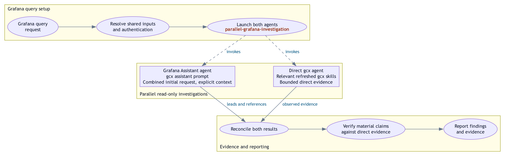

# Parallel Grafana Investigation

Every user-requested Grafana query uses two independent methods at the same time:
Grafana Assistant supplies leads, while a direct agent uses gcx and the relevant bundled
gcx agent skills to gather evidence. The orchestrator prepares their shared scope,
reconciles the results and verifies material claims before answering.

This skill was generalized from `parallel-alert-investigation`. The name
`parallel-grafana-investigation` describes its expanded coverage: alerts, exact queries,
metrics, logs, traces, inventory, SLOs, Synthetic Monitoring and other resource reads.
The runtime instructions live in [SKILL.md](SKILL.md); this README explains them.

<picture>
  <source media="(prefers-color-scheme: dark)" srcset="../../diagrams/DIAGRAM-parallel-alert-investigation-dark.png">
  
</picture>

The launch activity highlights this skill in orange. Ovals are activities, boxes are
agent calls, solid arrows are handoffs, and dashed arrows invoke agents. The request
already authorizes read-only work; the visual pattern introduces no separate approval
step. Assistant-disabled and degraded runs follow the rules below. This depicts the
workflow, not evidence of an executed investigation. See the
[diagram source and regeneration notes](../../diagrams/DIAGRAM-parallel-alert-investigation.md).

## How the work is divided

The split is by investigation method. Both agents answer the same request within the
same authorized scope. An inventory read remains an inventory read; an exact query is
not expanded into open-ended root-cause analysis.

| Participant | Responsibility | Result |
| --- | --- | --- |
| Orchestrator | Resolve shared inputs and authentication, launch both branches, reconcile results and verify claims | Direct observed results and evidence-backed findings with gaps and limitations |
| Grafana Assistant agent | Submit the same request using `gcx assistant prompt`, a fresh conversation, explicit context and read-only constraints | Leads, references, conversation/response identifiers and limitations |
| Direct gcx agent | Load and execute relevant refreshed gcx agent skills through the active harness; run bounded dedicated gcx reads independently | Direct query data and resource evidence |

### Shared scope and concurrent launch

The orchestrator resolves the exact request or expression, Grafana context, resource and
datasource identities, environment, filters, result limits, requested output, and
read-only scope. Temporal requests also share the same exact range or instant timestamp and timezone.
Non-temporal inventory marks these not applicable rather than inventing a window or
asking for an alert identity. Missing inputs are clarified only when needed for the
request; context is never guessed through live discovery. Authentication is prepared
in the orchestrating session using [gcx-cli](../gcx-cli/SKILL.md).

Both agents launch before either result is awaited. The direct agent never waits for
Assistant or duplicates its prompt. Exact expressions and parameters remain unchanged;
Assistant suggestions do not replace the requested query. Within a multi-store task,
this pair nests inside the Grafana branch under
[Per-Store Fan-Out](../per-store-fan-out/SKILL.md), including for non-alert reads.
The request authorizes the read-only work without a separate plan-approval pause.

There is one pair per resolved Grafana request or existing Grafana store branch, not
per command. Setup, refresh, discovery, verification and follow-up commands stay with
the existing owner. Historical endpoint reads retain their existing ownership and
no-new-prompt restrictions. Internal commands never recursively launch new pairs.
Setup-only installation or authentication requests use gcx-cli; an explicitly requested
resource query after setup enters this two-agent workflow.

### Relevant bundled skills

The direct agent selects guidance for the actual operation instead of assuming every
request is an alert:

| Request | Example bundled skills |
| --- | --- |
| Alert investigation | `investigate-alert` |
| Metrics, logs, traces and cross-signal diagnosis | `debug-with-grafana`, `gcx` |
| Dashboard inspection and inventory | `manage-dashboards` |
| SLO health and investigation | `slo-check-status`, `slo-investigate` |
| Synthetic Monitoring health and failures | `synth-check-status`, `synth-investigate-check` |
| Other resource reads and exact queries | Relevant refreshed skill and `gcx` command discovery |

The current bundle is authoritative; the table illustrates selection rather than fixing
an exhaustive catalog. The direct agent enforces the selected context, requested window,
filters and limits over example defaults. It uses gcx and gcx agent skills only and
never sends an Assistant prompt, even when bundled guidance suggests doing so.

`gcx agent skills get <name>` only displays instructions. Actual execution happens
through the active agent harness following those instructions and issuing gcx reads;
there is no invented shell command that substitutes for skill execution.

### Reconciliation and audit evidence

The orchestrator verifies that shared inputs match, reconciles the returned evidence,
and verifies material claims against retrievable direct evidence. Delegated output
from either branch remains leads until verified. Report disagreements, gaps, unavailable
signals and limitations. Exact queries return observed direct results; capped listings
do not establish exhaustive inventories. A successful connection is not query success,
and empty data alone does not establish health.

Every run records a local fan-out manifest accounting for both branches, including
degraded and Assistant-disabled runs, actual identities and launch times or nulls for
unlaunched branches, and the bundled skills used by the direct branch. Cite it from the
report or response's Source snapshot. When the requested output excludes prose or
citations, retain the Source snapshot and manifest reference in the local audit record
instead, preserving the requested answer format. The schema, native harness launching and continuation, capacity,
degradation and leads-versus-findings rules belong to the
[Shared Delegation Contract](../per-store-fan-out/references/delegation-contract.md).

A compatible parent-prepared `grafana-assistant-search` handoff can share the initial
Assistant prompt under [Assistant matching](../rhyming-incident-search/references/assistant-search.md).
Preserve its original request, exact scope and windows, endpoint-specific children and
manifest rows, and shared execution receipt. Do not broaden scope to combine requests,
start duplicate matching prompts, or automatically prompt again for late requests.
The Assistant branch uses `gcx assistant prompt`, rather than
`gcx assistant investigations create`; the two branches here are active-harness agents.

## Grafana Assistant incurs additional cost and can be disabled

**Grafana Assistant incurs additional cost beyond ordinary Grafana usage.** It is
enabled by default. Disable it by instruction, or place this line in task Resources:

```text
Grafana Assistant: disabled
```

**When disabled, only gcx and the relevant gcx agent skills are invoked for Grafana
query work.** Only the direct gcx agent runs. No Assistant prompt is sent, directly or
indirectly through bundled guidance. Honor the setting for its stated scope without
asking again. Record the disabled Assistant branch as a configured limitation, not a
failure; the requested queries still proceed and both branches remain in the manifest.

When Assistant is enabled but unavailable or denied, retain the exact sanitized failure
and continue the direct branch if reads remain available. Never switch context to make
it succeed. Avoid duplicate starts and unnecessary billable retries. If parallelism is
unavailable, disclose the limitation and record the actual execution under the shared
contract; sequential or inline work must not be represented as parallel delegation.
Parent delegation disable settings also apply to nested work.

Both agents are read-only. Resource changes, acknowledgments, messages and publication
require separate authorization. Reading guidance or installing the suite grants no
write authority.

## How the bundle in ~/.agents/skills is used

The skill references official gcx skills by name. The repository's
[gcx-cli preparation rules](../gcx-cli/SKILL.md#detect-the-harness-and-prepare-all-gcx-skills)
select the portable bundle in `~/.agents/skills` for Codex. They require
`gcx agent skills update`, followed by `gcx agent skills install --all` to add missing
bundled skills; update alone does not install newly bundled skills. Use a verified
alternative root consistently and explicitly for install, update and list operations.

Refresh the detected harness's skills before each operational gcx command, including
context checks, authentication, Assistant, discovery and telemetry reads. Bootstrap
help, inventory, installation, refresh and content loading are exceptions, preventing
recursive refresh. Stop dependent operations if refresh fails rather than silently
using stale guidance. Read only relevant refreshed skills. Claude Code uses its
official gcx plugin rather than assuming Codex's portable installation location.

During the original explanation, `~/.agents/skills/investigate-alert/SKILL.md` was confirmed
present. Its inspected guidance covered locating alerts, checking type/state, querying
datasources, examining trends/baselines and extracting runbook/dashboard links. That
observation proved local presence then; it did not prove refresh or live execution.

## Is this README loaded when the skill is read?

No. Codex initially exposes skill metadata and reads the selected `SKILL.md` when it
applies. Supporting files enter context through separate reads, not automatic directory
inclusion. See the official [skill loading documentation](https://learn.chatgpt.com/docs/build-skills).

`SKILL.md` links this README as optional explanatory documentation. The link makes it
discoverable; it does not automatically load it or require an extra runtime read.
A user request or explicit instruction to read the README directs that additional step.
Required execution rules remain in `SKILL.md` and its owning contracts.
